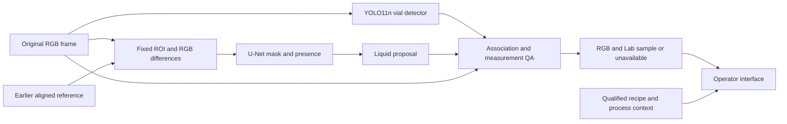

# Architecture

The system inspects the vial under the filling nozzle. It detects accumulated
liquid, extracts a color sample when the image supports one, and presents
recipe-related evidence to an operator. Camera observations supplement the
existing line; the software does not command its PLC, sorter or valves.

## Processing path

[Downloadable diagram](assets/architecture.svg) · [PNG](assets/architecture.png)

YOLO and U-Net can run on the approved GPU host; the portable Docker demo uses
CPU inference. CPU work also handles source decoding, reference management,
geometry, measurement QA and application state. The API carries
observations and operator responses; it is not a model stage.

## What is implemented

| Component | Implementation | Status |
| --- | --- | --- |
| Vial geometry | Released YOLO11n checkpoint; invocation in [the benchmark](../setup/vision/benchmark_temporal_pipeline.py) | Tested in recorded-frame experiments |
| Liquid mask and presence | [TemporalPool](../setup/vision/temporal_pool.py) and [frozen U-Net definition](../setup/vision/train_pair_masks.py) | Portable paired-image inference and example verification |
| Sampling | [VialGeometry](../replay/geometry.py), [Extractor](../replay/measurement.py), [Config](../replay/config.py) | Existing geometry, tracking and color QA |
| Reference qualification | [ReferenceGate](../replay/operator/commissioning.py) | Evidence checks; capture/alignment must be supplied by an adapter |
| Human evaluation | [Mask review and scorers](../annotation_review/README.md) | Explicit presence, mask and onset review |
| HTTP and UI | [FastAPI](../api/main.py), [React](../client/src/App.tsx) | Source ingestion, model overlays, QA evidence, persistent history and operator responses |
| Operator loop | [Model adapter](../api/pipelines/temporal.py) and [runtime](../integration/runtime.py) | Long-lived YOLO/U-Net and unchanged QA; browser seek/capture clocks remain distinct from native PTS |

Development branches contain additional dashboard and comparator work. The selected operator adapter is integrated on `austin-work`; recipe references and physical qualification remain separate commissioning work.

## Liquid model

The selected model is a small GroupNorm U-Net with 16/32/64/128 channels, a
segmentation head and a presence head. It starts from random weights. Faster
R-CNN and SAM are not required by this liquid branch.

Inputs are original RGB images at 640 × 480: the current frame and an earlier
reference from the same camera geometry. The liquid ROI is
`[256, 240, 368, 432]`, or 112 × 192 pixels. It is fixed; YOLO does not crop or
reposition the U-Net input.

Preprocessing uses the median RGB in anchor `[32, 160, 80, 208]` to correct
current-frame gain. The reference/current gain ratio, with a 0.005 offset, is
clamped to 0.65–1.55. The network receives six channels: signed RGB differences
and their absolute values. Gain correction affects network inputs only; color
measurement always uses the original frame.

Both output thresholds are 0.5. The runner retains the raw binary mask, its
largest connected component and the presence score. It emits a liquid proposal
only when presence passes and the component is nonempty. A rejected proposal
gets a zero proposal mask. No proposal does not establish an empty vial.

This is a paired-image network, not a recurrent model. It has no internal
reference capture/reset policy and does not use future frames. The example
references are unreviewed, not confirmed-empty observations.

## Vial association and measurement QA

The released YOLO checkpoint contains vial and liquid classes. Use class 0
for vial geometry; the U-Net supplies liquid evidence in this design.
The matched benchmark uses image size 640, `rect=False`, confidence 0.35 and
NMS IoU 0.45. These settings are recorded experiment inputs, not calibrated
recipe acceptance thresholds.

Geometry selects one vial at the configured fill position. Missing or ambiguous
vials reset tracking. It requires a stable track, one associated liquid
proposal with at least 90% box containment, and a sufficiently large colored
interior. The sampling mask excludes walls, the base, glare and disconnected
regions. Motion, clipping, holder geometry and erosion sensitivity can reject
the sample. These checks intentionally limit sampling of tiny or clear pools.

`Extractor.measure()` returns `measurement_valid`, `quality_flags`, source RGB
and Lab values, geometry and the actual sampling mask. That mask differs from
the raw model mask. A plausible proposal can therefore coexist with unavailable
color measurement. Display both states; do not replace QA with a model score.

## Reference and recipe qualification

A deployment adapter must supply an independently reviewed empty reference,
camera/profile identity and alignment evidence. `ReferenceGate` checks native
clock ordering and invalidates temporal references on stream/context changes,
rewinds, profile changes or declared discontinuities. It consumes attestations;
it does not determine that an image is empty or aligned.

Recipe comparison additionally requires the intended recipe, an independently
accepted endpoint reference, confirmed fill completion and physical vial
identity. A recognized color alone does not establish recipe agreement. Operator
acknowledgement records a response; it does not approve product release.

## Worker and application contract

The model-only CLI writes `temporal-pool-proposal/v1`: masks, presence, source
file/RGB hashes, checkpoint identity and an unreviewed reference status. It
does not provide native video timing or measurement QA.

The video worker must attach the source clock and wrap results for the
`station-evidence/v1` checks in `commissioning.py`:

| Group | Required information |
| --- | --- |
| Source | Camera/stream/source IDs, dimensions, decoded RGB hash, decoded frame index, native PTS/time base and clock domain |
| Target | Fill-position target/context ID and physical vial ID when independently established |
| Model output | Raw mask, accepted proposal, presence, vial geometry and model hashes |
| Measurement | Actual sampling mask, QA outcome/reasons, raw-source RGB/Lab |
| Qualification | Profile, reference identity/status and alignment evidence |

Publish image, masks and result together with one source identity. On dropped
frames or reset, discard obsolete results and reset the relevant state. A
dashboard should distinguish no proposal, failed sampling QA, a usable sample
with unqualified recipe context, and an eligible recipe comparison. Missing
evidence must not become an automatic “good” result.

See [development](development.md) for the runnable model example,
[evaluation](evaluation.md) for results, and [operations](operations.md) for
the integration rehearsal.

## Laptop runtime

[Docker Compose](../compose.yaml) starts a CPU model API and the built React UI
behind Nginx. Source and rendered artifacts are stored separately. Per-run model
state resets on reference/source changes, rewinds and independent stills. Model
inference is serialized off the HTTP event loop; queue capacity is 32 frames.
A run-generation boundary rejects obsolete HTTP/WebSocket updates after reset.
Live stopped, offline and stale states take precedence over the last measurement.

On the GB10, [the native launcher](../setup/gb10/README.md) runs the same API in one
uvicorn process on CUDA or CPU. With `APP__CLIENT_DIST` set, it serves the prebuilt React UI
from the same origin instead of Nginx. Model, QA and storage code are identical.

The adapter retains actual QA and reference/source/model identities. Model proposals
and sampling masks remain separate; uploaded/configured references stay explicitly
unreviewed. The app can demonstrate visual evidence without inventing an eligible
recipe comparison or product approval. [Run the demo](demo.md).

## Recipe-first vial check

The monitor asks the operator for the next vial's recipe before filling, standing in for a
future recipe feed. When a vial finishes (end of a one-vial recording, or FINISH VIAL on the
camera), the UI takes the median Lab of QA-valid samples in its last 6 s and computes CIEDE2000
to the recipe's reference colour and to the last different recipe
([recipeCheck.ts](../client/src/services/recipeCheck.ts)). Band 5 and direction cosine 0.8
are research settings. The result maps to a simulated GOOD/SCRAP/HOLD action that the operator
confirms or overrides; the decision is stored as an attributed acknowledgement. No line
equipment is contacted. References come from the Run5 retrospective proxies or from vials the
operator accepts (browser-local). Model inference and measurement QA are unchanged.

## Investigation

The [Investigation panel](investigation.md) consumes separately imported,
source-bound completed-vial endpoints after QA. `replay.diagnostics` produces
candidate explanations, supporting evidence and next checks. Frames do not become
vials automatically. The run remains unavailable until the required inputs exist;
synthetic examples are labeled and cannot become real run evidence. Diagnosis
records append to SQLite and leave model/measurement/operator decisions unchanged.
