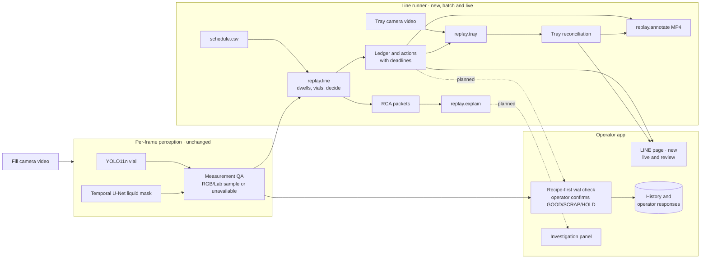
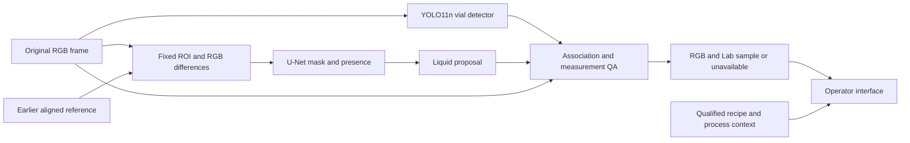
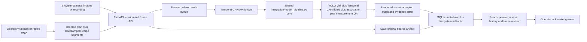
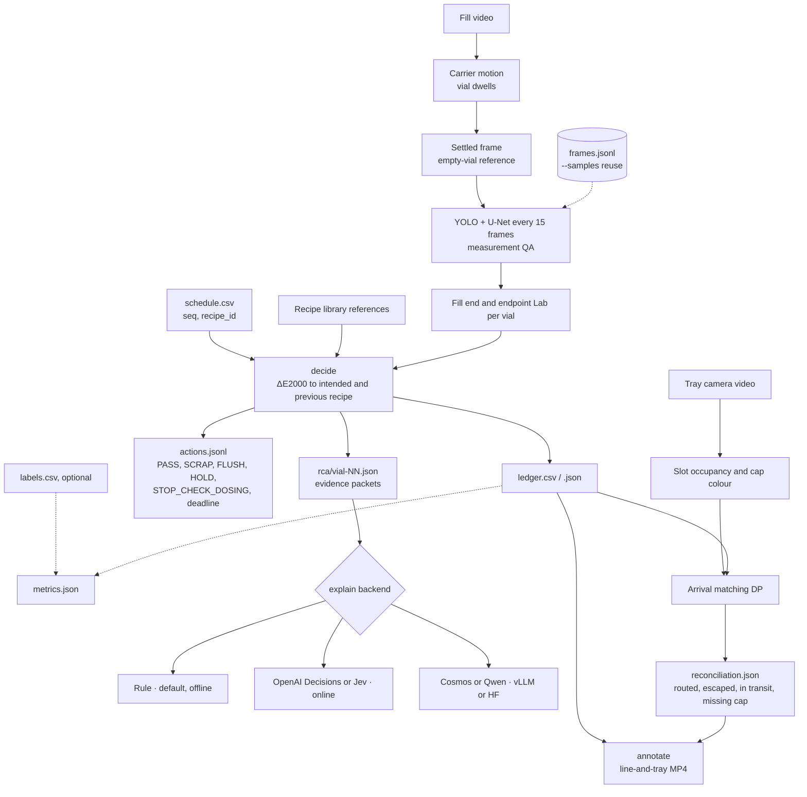

# Architecture

The system inspects the vial under the filling nozzle. It detects accumulated
liquid, extracts a color sample when the image supports one, and presents
recipe-related evidence to an operator. Camera observations supplement the
existing line; the software does not command its PLC, sorter or valves.

## System overview

The per-frame perception and measurement feed two consumers. The operator app checks one
vial at a time, and a person confirms each vial. The line runner processes a whole run from
the recipe schedule. It adds actions with deadlines, finished-tray reconciliation and
root-cause packets. It runs as a batch command or live: `replay.live` emits each decision when
the carrier moves the vial on, and the app's LINE page shows it as it happens
([line view](line-view.md)). The dotted links are planned, not built.

[SVG](assets/architecture-system.svg) · [PNG](assets/architecture-system.png)

## Processing path

[Downloadable diagram](assets/architecture.svg) · [PNG](assets/architecture.png)

YOLO and U-Net can run on the approved GPU host; the portable Docker demo uses
CPU inference. CPU work also handles source decoding, reference management,
geometry, measurement QA and application state. The API carries
observations and operator responses; it is not a model stage.

## Application/runtime flow

Recipe resolution happens before inference so every work item retains the
recipe context active at its source timestamp. The shared model core does not
query the database or decide recipe compliance. The bridge owns API adaptation
and per-run QA state; persistence owns evidence history; the React application
displays those states to an operator. No component commands the PLC.

The operator can arrange a planned vial order directly on the LINE page or in Monitor,
including recipe ID, name, an expected-color label/swatch and Tank 100/200/300/400 volumes in mL. The
UI derives the displayed total from those tank amounts. The plan is durable run
intent, not a vision result or calibrated acceptance reference. During an operator-led run,
activating a planned vial creates the timestamped recipe boundary used by later
frames. Recording replay may instead import authoritative timestamped segments.

## What is implemented

| Component | Implementation | Status |
| --- | --- | --- |
| Vial geometry | Released YOLO11n checkpoint; invocation in [the benchmark](../setup/vision/benchmark_temporal_pipeline.py) | Tested in recorded-frame experiments |
| Liquid mask and presence | [TemporalPool](../setup/vision/temporal_pool.py) and [frozen U-Net definition](../setup/vision/train_pair_masks.py) | Portable paired-image inference and example verification |
| Sampling | [VialGeometry](../replay/geometry.py), [Extractor](../replay/measurement.py), [Config](../replay/config.py) | Existing geometry, tracking and color QA |
| Reference qualification | [ReferenceGate](../replay/operator/commissioning.py) | Evidence checks; capture/alignment must be supplied by an adapter |
| Human evaluation | [Mask review and scorers](../annotation_review/README.md) | Explicit presence, mask and onset review |
| HTTP and UI | [FastAPI](../api/main.py), [React](../client/src/App.tsx) | Persistent inspection sessions, image/recording intake, run history, frame review and operator acknowledgement |
| Shared model core | [model_pipeline.py](../integration/model_pipeline.py) | Srijan's consolidated integration: YOLO vial geometry → paired Temporal CNN liquid proposal → vial association → measurement QA → render/mask |
| Asset-bundle adapter | [temporal.py](../api/pipelines/temporal.py) and [runtime](../integration/runtime.py) | Model mode when `APP__MODEL_ASSETS` is set (GB10 kit, Docker): the same models from the hash-checked release bundle |
| Frame worker and operator loop | [InspectionService](../api/services/inspection.py), [Temporal CNN bridge](../api/pipelines/temporal_cnn_bridge.py) | Load-once model mode connects queued frames to the shared model core and stored render/mask artifacts |
| Line runner | [line](../replay/line.py), [decide](../replay/decide.py), [explain](../replay/explain.py), [tray](../replay/tray.py), [annotate](../replay/annotate.py), [live](../replay/live.py) | Video + recipe schedule → vial ledger, actions with deadlines, RCA packets/explanations, finished-tray reconciliation, annotated video. Batch, or live through the app's [LINE page](line-view.md) |
| Recipe order (offline, not in the app) | [schedule](../replay/schedule.py), [carryover forecast](../replay/carryover_forecast.py) | Recipe queue + reference colours + residue fraction f → forecast ΔE per vial from what the line holds, flushes per changeover, and a proposed run order (or a re-plan from the last vial's measured colour). Advice only; f is a line setting |
| Recording ingestion | Browser-sampled decode, millisecond seek timestamps, original recording storage and recipe-segment import | Integrated with the frame queue; native PTS/time-base backend decoding and a full rehearsal remain pending |

Model mode is opt-in and requires the released checkpoints plus an explicit
reference image. The default remains deterministic mock mode. This table
describes the code in this branch, not an assumed deployment.

## Liquid model

The selected model is a small GroupNorm U-Net with 16/32/64/128 channels, a
segmentation head and a presence head. It starts from random weights. Faster
R-CNN and SAM are not required by this liquid branch.

Inputs are original RGB images at 640 × 480: the current frame and an earlier
reference from the same camera geometry. The liquid ROI is
`[256, 240, 368, 432]`, or 112 × 192 pixels. It is fixed; YOLO does not crop or
reposition the U-Net input.

Preprocessing uses the median RGB in anchor `[32, 160, 80, 208]` to correct
current-frame gain. The reference/current gain ratio, with a 0.005 offset, is
clamped to 0.65–1.55. The network receives six channels: signed RGB differences
and their absolute values. Gain correction affects network inputs only; color
measurement always uses the original frame.

Both output thresholds are 0.5. The runner retains the raw binary mask, its
largest connected component and the presence score. It emits a liquid proposal
only when presence passes and the component is nonempty. A rejected proposal
gets a zero proposal mask. No proposal does not establish an empty vial.

This is a paired-image network, not a recurrent model. It has no internal
reference capture/reset policy and does not use future frames. The example
references are unreviewed, not confirmed-empty observations.

## Vial association and measurement QA

The released YOLO checkpoint contains vial and liquid classes. Use class 0
for vial geometry; the U-Net supplies liquid evidence in this design.
The matched benchmark uses image size 640, `rect=False`, confidence 0.35 and
NMS IoU 0.45. These settings are recorded experiment inputs, not calibrated
recipe acceptance thresholds.

Geometry selects one vial at the configured fill position. Missing or ambiguous
vials reset tracking. It requires a stable track, one associated liquid
proposal with at least 90% box containment, and a sufficiently large colored
interior. The sampling mask excludes walls, the base, glare and disconnected
regions. Motion, clipping, holder geometry and erosion sensitivity can reject
the sample. These checks intentionally limit sampling of tiny or clear pools.

`Extractor.measure()` returns `measurement_valid`, `quality_flags`, source RGB
and Lab values, geometry and the actual sampling mask. That mask differs from
the raw model mask. A plausible proposal can therefore coexist with unavailable
color measurement. Display both states; do not replace QA with a model score.

## Reference and recipe qualification

A deployment adapter must supply an independently reviewed empty reference,
camera/profile identity and alignment evidence. `ReferenceGate` checks native
clock ordering and invalidates temporal references on stream/context changes,
rewinds, profile changes or declared discontinuities. It consumes attestations;
it does not determine that an image is empty or aligned.

Recipe comparison additionally requires the intended recipe, an independently
accepted endpoint reference, confirmed fill completion and physical vial
identity. A recognized color alone does not establish recipe agreement. Operator
acknowledgement records a response; it does not approve product release.

Imported recipe CSV rows are timeline context: the API resolves each frame to
the segment covering its source timestamp. Importing a recipe ID/name does not
provide expected color values or acceptance thresholds and therefore cannot turn
measurement QA into recipe pass/fail. Exact repeated rows are ignored on import.
When present, recipe formula fields and descriptive color intent are retained for
operator display, but descriptive color labels still do not qualify a reference.

## Worker and application contract

The model-only CLI writes `temporal-pool-proposal/v1`: masks, presence, source
file/RGB hashes, checkpoint identity and an unreviewed reference status. It
does not provide native video timing or measurement QA.

The current frame API preserves a supplied source timestamp and recipe context,
but a recording decoder must still attach the native source clock and wrap
results for the
`station-evidence/v1` checks in `commissioning.py`:

| Group | Required information |
| --- | --- |
| Source | Camera/stream/source IDs, dimensions, decoded RGB hash, decoded frame index, native PTS/time base and clock domain |
| Target | Fill-position target/context ID and physical vial ID when independently established |
| Model output | Raw mask, accepted proposal, presence, vial geometry and model hashes |
| Measurement | Actual sampling mask, QA outcome/reasons, raw-source RGB/Lab |
| Qualification | Profile, reference identity/status and alignment evidence |

Publish image, masks and result together with one source identity. On dropped
frames or reset, discard obsolete results and reset the relevant state. A
dashboard should distinguish no proposal, failed sampling QA, a usable sample
with unqualified recipe context, and an eligible recipe comparison. Missing
evidence must not become an automatic “good” result.

See [development](development.md) for the runnable model example,
[evaluation](evaluation.md) for results, and [operations](operations.md) for
the integration rehearsal.

## Laptop runtime

[Docker Compose](../compose.yaml) starts a CPU model API and the built React UI
behind Nginx. Source and rendered artifacts are stored separately. Per-run model
state resets on reference/source changes, rewinds and independent stills. Model
inference is serialized off the HTTP event loop; queue capacity is 32 frames.
A run-generation boundary rejects obsolete HTTP/WebSocket updates after reset.
Live stopped, offline and stale states take precedence over the last measurement.

On the GB10, [the native launcher](../setup/gb10/README.md) runs the same API in one
uvicorn process on CUDA or CPU. With `APP__CLIENT_DIST` set, it serves the prebuilt React UI
from the same origin instead of Nginx. Model, QA and storage code are identical.

The adapter retains actual QA and reference/source/model identities. Model proposals
and sampling masks remain separate; uploaded/configured references stay explicitly
unreviewed. The app can demonstrate visual evidence without inventing an eligible
recipe comparison or product approval. [Run the demo](demo.md).

## Recipe-first vial check

The monitor asks the operator for the next vial's recipe before filling, standing in for a
future recipe feed. When a vial finishes (end of a one-vial recording, or FINISH VIAL on the
camera), the UI takes the median Lab of QA-valid samples in its last 6 s and computes CIEDE2000
to the recipe's reference colour and to the last different recipe
([recipeCheck.ts](../client/src/services/recipeCheck.ts)). Band 5 and direction cosine 0.8
are research settings. The result maps to a simulated GOOD/SCRAP/HOLD action that the operator
confirms or overrides; the decision is stored as an attributed acknowledgement. No line
equipment is contacted. References come from the Run5 retrospective proxies or from vials the
operator accepts (browser-local). Model inference and measurement QA are unchanged.

## Line runner

`python -m replay.line` takes one fill video, a `schedule.csv` (`seq,recipe_id`) and the recipe
library:

1. **Vial dwells.** It finds them from carrier motion.
2. **Reference.** The frame just after the carrier settles is the empty-vial reference.
3. **Sampling.** It runs the unchanged YOLO/U-Net/QA path every 15 frames.
4. **Endpoint.** It takes the endpoint Lab for each vial. The n-th filled vial is schedule
   row n.
5. **Decision.** `decide` compares the endpoint against the intended recipe and the previous
   recipe (ΔE2000). It issues simulated actions with deadlines.

`--samples` reruns stages 4 and 5 from an earlier `frames.jsonl` without the models.

`replay.tray` reads the cap/seal camera on the same clock. It requires a clear view of both
profiled 5×6 sorting grids before establishing the session baseline, reserves arbitrary starting inventory
already present, and detects the first new arrival in any open slot in either grid rather than
assuming R1C1. Large connected changes relative to that baseline hold detections while the robot
arm occludes the trays. It matches arrivals to departures in the ledger, then reports routing,
escapes, vials in transit and missing caps. The deployed CSI grids are an explicit station-profile
candidate; their coordinates and transfer evidence do not establish source-matched accuracy.

`replay.explain` scores RCA backends on the evidence packets. The rule baseline is the
default and works offline. See [evaluation](evaluation.md) for the comparison.

[SVG](assets/architecture-line-runner.svg) · [PNG](assets/architecture-line-runner.png)

`python -m replay.line` decides after the whole video. `replay.live` runs the same stages one
frame or stored sample at a time and emits events as they become known. On Run 5 it gives the
same 30 verdicts, the same 39 actions and the same 26 tray matches as the batch path; the
differences are listed in [line view](line-view.md). On-site deployment is in
[deploy-gb10-line](deploy-gb10-line.md).

## Investigation

The [Investigation panel](investigation.md) consumes separately imported,
source-bound completed-vial endpoints after QA. `replay.diagnostics` produces
candidate explanations, supporting evidence and next checks. Frames do not become
vials automatically. The run remains unavailable until the required inputs exist;
synthetic examples are labeled and cannot become real run evidence. Diagnosis
records append to SQLite and leave model/measurement/operator decisions unchanged.
