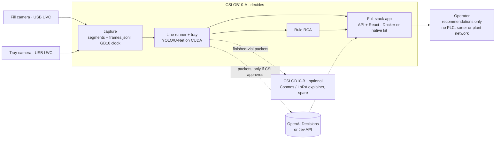

# Deploying the line runner on GB10s at CSI

Plan for running the whole pipeline on site:

1. capture of the fill and tray cameras;
2. per-vial verdicts and actions;
3. tray reconciliation;
4. annotated video;
5. RCA.

The target is **CSI's own GB10(s)**, not our campus Spark. We also don't use CSI's inspection
software.

**What we know about CSI's GB10:**

| Fact | Status | What follows |
| --- | --- | --- |
| GPU support | Confirmed | The models run on CUDA |
| Internet access | Confirmed | Online install, and the online RCA APIs are possible (data leaving the site still needs CSI's approval) |
| Admin rights | Confirmed | apt packages such as `ffmpeg` can be installed if needed |
| Tk and the Linewatch recorder | Confirmed: CSI's recorder (`Linewatch-recorder`) ran there | A known-good capture fallback |
| Docker | Assumed, not confirmed | Ship two builds: Docker and native |

**The deliverable is the full-stack app** (FastAPI and React) with the line runner behind it.
CLI scripts or the recorder GUI on their own are not enough. It comes in two builds that run
the same code:

- **Docker:** `compose.yaml` plus `compose.gpu.yaml`, through `onboard.sh`.
- **Native:** the self-contained kit with bundled Python, used if Docker or the NVIDIA
  Container Toolkit is missing.

`START.sh --check` records which build applies on the first morning.

The plan builds on the existing GB10 kit ([setup/gb10](../setup/gb10/README.md),
`linewatch-gb10-v1.1.0`). It has passed its self-test on GB10 hardware (40/40 on CUDA). Both
builds currently serve the per-frame app only. Neither `api/Dockerfile` nor `build-kit.sh`
copies the line runner yet (`replay.line`, `replay.decide`, `replay.tray`, `replay.annotate`,
`replay.explain`).

The plan makes no connection to the line: no PLC, no sorter, no industrial network. Actions are
recommendations shown to the operator and logged. Cameras are UVC devices plugged into the GB10.

## Target layout



[SVG](assets/architecture-deploy-gb10.svg) · [PNG](assets/architecture-deploy-gb10.png)

The online RCA APIs send evidence packets, and with images, vial crops, off site. They are
used only if CSI approves. The rule baseline is the fallback.

GB10-A and GB10-B are both CSI machines.

- **GB10-A runs everything that decides.**
  - Two 640×480 streams are light.
  - The kit's models run at about 90 ms per frame on CUDA, HTTP included.
  - The runner samples dwells, not every frame.
- **GB10-B is optional.**
  - It runs the VLM explainer, so a 7B model at about 17 s per vial never competes with the
    decision path for the GPU.
  - It is also the spare if A fails.
- **With only one GB10,** the VLM runs on A after the session, or not at all.
  - RCA does not need the VLM. On Run 5, the rule baseline and the OpenAI Decisions API were
    both consistent with the evidence on 20/20 vials; zero-shot Cosmos was consistent on 6/20
    (see [evaluation](evaluation.md)).
  - The Decisions API is the online option, because CSI's GB10 has internet. It is used only
    if CSI approves sending packets and vial crops off site. Otherwise the rule baseline is
    used.
- **Both cameras use the GB10's clock.**
  - The capture step stamps every frame with `CLOCK_MONOTONIC` and wall time.
  - This removes the burned-in-clock matching we needed for Run 5. There, the two clocks agreed
    within about 20 ms.

## Software on the box

| Piece | Status | Work |
| --- | --- | --- |
| Python 3.12, torch cu130, OpenCV, numpy | In the kit lock (`lock-cuda.txt`) | none |
| Fill models (YOLO11n + temporal U-Net) | In the kit; self-test 40/40 on GB10 hardware | Rerun the self-test on CSI's GB10 (gate 1) |
| `replay.line/decide/tray/annotate/explain` | On `austin/line-runner` | Copy the modules in both builds: `api/Dockerfile` and `build-kit.sh`. Both already copy `integration/runtime.py` |
| Capture | The Linewatch recorder (Tk GUI) ran on CSI's GB10 | New headless `replay/capture.py`, started from the app: OpenCV V4L2, MJPEG 640×480 at 30 fps per camera. Writes 60 s MJPEG segments and a `frames.jsonl` of `(camera, frame, mono_ns, wall)`. The recorder is the fallback |
| App views of run outputs | The app shows the per-vial check only | API endpoints and React pages for the ledger, actions, reconciliation and RCA, with start/stop for capture and line runs (Josiah) |
| H.264 output | The kit has no `ffmpeg`; the Docker image can install it | Docker: add `ffmpeg` with apt. Native: put `imageio-ffmpeg` (ships an aarch64 binary) in the lock. `annotate.py` falls back to OpenCV `mp4v` |
| Kit entry points | `START.sh` serves the app only | `START.sh capture`, `START.sh line`, `START.sh selftest-line`, which the app also calls |
| Online RCA | `explain.py --backend decisions` / `jev` | The key comes from an environment variable at launch and is never stored in the kit or the repo. Used only with CSI's approval |
| VLM explainer (GB10-B) | Run 5 results came from a separate env (torch 2.11, transformers 5.20) | A separate `cosmos` lock. Weights download from Hugging Face over CSI's internet; a USB bundle of about 16 GB per 7B model is the backup. Load by snapshot path |

The Linewatch recorder (`Linewatch-recorder`, the Tk capture GUI) is the tool CSI gave us,
and it ran on their GB10. Tk and its dependencies are therefore present. It is the proven
fallback if `capture.py` fails gate 4. Its `vial_log.csv` is the way to write down ground
truth, and `capture.py` writes the same columns. `capture.py` is still the primary capture,
for three reasons:
- it runs headless from the app;
- it stamps both cameras on one GB10 clock;
- it writes the segment layout that live mode tails.

**Two builds, same code** (`START.sh --check` reports which applies):

| CSI GB10 has | Build | How |
| --- | --- | --- |
| Docker and the NVIDIA Container Toolkit (stock DGX OS ships both) | **Docker** | `onboard.sh`: `compose.yaml` plus `compose.gpu.yaml`. The API container gets `/dev/video*` and a results volume |
| No working Docker or toolkit | **Native** | The kit's `START.sh` with bundled Python and hash-locked wheels. One uvicorn process serves the API and the built UI |
| Internet lost on the day | Either build | The offline kit (`wheels/`, models), rule RCA, and Cosmos from USB |

## Calibration on site (per camera mount)

The fill ROI and the Good/Bad tray slot grid (`GOOD_SLOTS`, `TRAYS` in `replay/tray.py`) are
pixel constants measured on the Run 5 view. A new mount needs new values. The plan uses a
reviewed file, not live auto-detection:

1. Run `START.sh capture --snapshot` with the trays empty, then again with the vial under the
   nozzle.
2. Run `python -m replay.tray --calibrate snapshot.png`. It writes `station.json` with the tray
   boxes and the 6×5 slot grid, proposed from the tray outline, and renders an overlay PNG.
3. A person checks the overlay and edits `station.json` if needed. Commit it with the session
   notes.
4. `line`, `tray` and `annotate` read `--station station.json`. The defaults stay the Run 5
   values.

Thresholds such as `OCCUPIED_DIFF`, `CAPPED_YELLOW` and the ΔE limits are **not** retuned on
site. They stay frozen from synthetic data. If they fail on CSI's view, we write that down,
not refit.

## Two run modes

**Mode 1: batch per run (day 1, lowest risk).** Record a full run, then process it:

```bash
bash START.sh capture --fill /dev/v4l/by-id/<fill> --tray /dev/v4l/by-id/<tray> --out ~/csi/<session>/run-01
# ... line runs; Ctrl-C ends the recording
bash START.sh line --run ~/csi/<session>/run-01 --schedule schedule.csv --station station.json
#  -> ledger.csv/json, actions.jsonl, reconciliation.json, rca/, line-and-tray.mp4
```

This is exactly the path we validated on Run 5. The only change is the input source.

**Mode 2: live (day 2, once mode 1 has passed on site).** The runner tails the capture
segments and decides each vial when its dwell closes:

- `replay.line` today calls `decide()` once, after all dwells. That needs to become a per-dwell
  call that appends to `actions.jsonl`. `decide` is already per vial with its previous vial as
  context, so this is a loop change, not a model change.
- `replay.tray` matches each arrival as it happens. The DP already handles in-transit tails.
- The operator page reads the ledger file, which is Josiah's app work.
- Budget: the deadline is the vial's arrival at the tray, at least 100 s after fill end on Run 5
  (median 128 s). The goal is ≤ 2 s from fill end to action, so there is a large margin.

## Validation gates (in order; stop at the first failure)

| Gate | Pass condition | Where |
| --- | --- | --- |
| 0. Kit build test | `selftest-line` passes on CPU (rebuilds the Run 5 ledger and reconciliation from stored samples) | Laptop/WSL before travel |
| 1. Kit self-test | `START.sh --check` facts saved; `START.sh --selftest`: 40/40 on CUDA | CSI GB10 |
| 2. Line self-test | A Run 5 clip and its samples rebuild the committed ledger and `reconciliation.json` byte for byte, and `line` run with the models matches the verdicts | CSI GB10 |
| 3. Throughput | Runner on the full Run 5 video keeps up with real time (≥ 10 frames/s as sampled) on CUDA. Record the measured speed in [evaluation](evaluation.md) | CSI GB10 |
| 4. Camera check | Both `/dev/video*` open at 640×480 MJPEG, no dropped frames over 10 min, `mono_ns` gaps < 50 ms | CSI GB10 |
| 5. Framing | Calibration overlay reviewed and `station.json` saved | CSI GB10 |
| 6. Dry run | 3 vials with a known recipe give the right verdicts, all 3 reach the tray in the reconciliation, and the annotated video is readable | CSI GB10 |

Only after gate 6: record the real session, mode 1, and then mode 2 if time allows. The CSI
session is real data. It is evaluation only and is never used for tuning, like Run 5.

## Work items

| # | Item | Size | Who |
| --- | --- | --- | --- |
| 1 | `replay/capture.py`: headless two-camera capture, segments plus frame clock log, `--snapshot`, `vial_log.csv` columns | ½ day | Austin |
| 2 | `--station station.json` in `line`/`tray`/`annotate`, and `tray --calibrate` with an overlay | ½ day | Austin |
| 3 | H.264 output: `ffmpeg` in the Docker image, `imageio-ffmpeg` in the native lock, `mp4v` fallback (regenerate the locks, rerun the self-test) | 2 h | Austin |
| 4 | Line-runner modules in `api/Dockerfile` and `build-kit.sh`; `START.sh capture/line/selftest-line`; camera devices and results volume in compose; kit v1.2.0 | ½ day | Austin |
| 5 | `selftest-line` plus gate 0 on the laptop, in both builds; online and offline kits on USB (exFAT) | 2 h | Austin |
| 6 | App: API endpoints and React pages for runs (start/stop capture, run the line, show the ledger, actions, reconciliation, RCA and video) | 1 day | Josiah + Austin |
| 7 | Per-dwell `decide` (live mode) and a live ledger tail in the app | 1 day | Austin + Josiah |
| 8 | Online RCA in the app: `decisions` backend with the key from the environment, rule fallback when offline or not approved | 2 h | Austin |
| 9 | Cosmos env for GB10-B (lock, `explain.py --backend hf`), for the LoRA once Zoe and Jev have one | ½ day | Zoe/Jev |

Items 1–6 give the full-stack app in mode 1 at CSI. Item 7 is the live demo. Items 8 and 9
are optional.

## Ask CSI before the visit

- How many GB10s, and is one free for us for the whole session? Is Docker installed, with the
  NVIDIA Container Toolkit? We bring both builds either way. GPU, internet and admin rights
  are already confirmed.
- May evidence packets and vial crops go to an external API (OpenAI Decisions) for root-cause
  explanations? If not, we use the on-box rule baseline.
- Can we mount our two USB cameras in the Run 5 positions, or use CSI's existing cameras over
  USB (UVC)? We do not use network cameras on their network.
- The recipe schedule for each run, in order (`seq,recipe_id`), and the Recipe Setup limits.
- Can recordings and results leave the site? This decides whether `upload-session.sh` is used.
