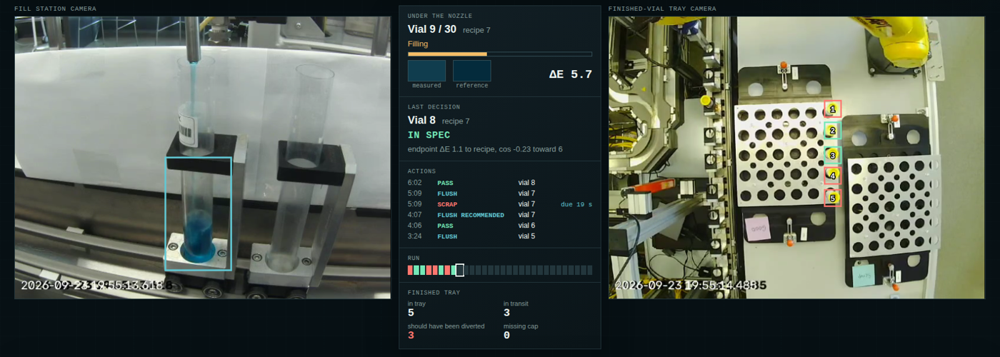

# Line view (LINE page)

The LINE page is the app's landing page (`/`; `/line` also works). The single-vial MONITOR page
moved to `/monitor`. With a station configured it opens on the station's live cameras.

The LINE page shows the fill-station camera, the finished-vial tray camera and an operator panel.
Each vial's verdict, actions and tray arrival appear when the engine produces them. It is the
annotated line-and-tray MP4, drawn by the app over the real videos instead of burned into a file.



## Modes

| Mode | Clock | What runs | Use |
| --- | --- | --- | --- |
| **Live** | The server's video clock, at 1–16×, with pause | `replay.live` runs on the server and sends each event over a WebSocket when it becomes known. The videos follow the clock | Demos and the CSI session |
| **Review** | The fill video's playhead (scrub freely) | The same engine over the whole recorded run, computed once. The page shows only the events with `t` ≤ playhead | Going back over a run after the fact |

The two modes show the same events. Live sends them as time passes; Review has them all and
reveals them as the playhead reaches each one.

**Live sources:**
- **Recorded model outputs:** the stored per-sample model results (`frames.jsonl`) and tray
  samples are replayed at the video clock. No GPU is needed. You can start part-way through;
  the engine catches up silently first.
- **Video → models now:** the server decodes the recordings and runs YOLO/U-Net on the fill
  frames as they arrive, as it would from a camera. It needs `APP__MODEL_ASSETS` (and the model
  dependencies) and starts at 0. This source is wired, but has **not yet been run with the
  models**. Without the models, its frame decoding, dwell detection and tray scanning match the
  stored Run 5 results (below).

## Live cameras (real time)

Run **Live cameras** (id `live`), source **Cameras (live, models now)**:
- **Capture.** The fill and tray cameras are read as their frames arrive, on one clock
  ([cameras.py](../replay/cameras.py)). They are opened the way CSI's Linewatch recorder
  opens them: MJPG 640×480, 30 warm-up frames so auto-exposure and white balance settle,
  and stable `/dev/v4l/by-id/` names resolved to the current `/dev/videoN` at every open.
  A camera that drops off the USB hub is reopened for up to 5 s; the missed frames are a gap,
  and the page counts reconnects.
- **Models.** YOLO/U-Net and measurement QA run on the vial under the nozzle every 0.5 s
  while the carrier is stopped.
- **Decisions.** Each vial is decided when the carrier moves it on.
- **Display.** The page shows both live feeds (MJPEG) with the same overlays.
- **Saving.** Each session records both feeds (H.264) and the model samples, and saves itself
  as a run. **Stop** shows a link to open it in Review.

**Measured on the laptop (RTX 4080 SUPER, native Windows Python, 2026-10-28):**
- Model load: 1.7 s, plus a warm-up inference at load.
- Model sample: 24 ms (p90 29 ms), against a 500 ms budget.
- Run 5 played through the camera input at real time for 130 s: 0 frames dropped, at most
  0.08 s behind. Vials 1–3 were decided at 28.0, 74.5 and 121.0 s, with the batch verdicts:
  OUT OF SPEC ΔE 12.48, IN SPEC 2.84, IN SPEC 2.05.

These runs used **simulated cameras**: the Run 5 videos played at real time through the same
camera input. Real webcams have not been connected. The repository rules leave that to the
person at the machine.

**Before relying on it:**
- **Aim the cameras to match the Run 5 framing.** The models read a fixed vial region
  (`[256, 240, 368, 432]` at 640×480), and the tray slot grid is fixed too. The overlays on the
  live feeds show where these are: aim each camera so the vial and the tray slots sit inside
  them. Per-mount calibration (`station.json` offsets) is still deploy work item 2.
- **Cameras must deliver 640×480.** Frames are never resized; a camera that cannot do
  640×480 is refused with an error.
- **Start the live session before the first vial.** Vials are numbered from the start of the
  session, and vial n takes recipe n of the recipe order.
- **At CSI these are the Run 5 cameras.** The fill camera is the recorder's `vial_fill`
  camera and the tray camera is its `cap_seal` camera, so if the mounts have not moved, the
  framing matches Run 5. Check the overlays before the first vial anyway. Other cameras or
  lighting (a laptop webcam, say) will be less accurate than on Run 5.
- **Close the Linewatch recorder first.** A camera can be open in only one program. The live
  session records both feeds itself (H.264, CRF 12 like the recorder), but not the
  recorder's vial log; keep that by hand if it is needed. Recorded runs have the recorder's
  timestamp burned in at the bottom left; live frames do not. It lies outside the vial region
  and the tray slots.
- **Both sorting grids are observed.** The tray preview tracks 30 Good slots and 30 Bad slots
  independently. `DETECTIONS ON` draws thin labeled station-profile regions for both sides and
  solid boxes only around committed occupied slots. Profiles with `tray_empty_slot_gray`
  initialize each open slot independently and do not wait for the entire scene or both trays to
  be empty. Legacy profiles show `WAITING FOR CLEAR VIEW OF BOTH SORT TRAYS` until their global
  baseline exists. Both grids come from `tray_slots` in the station manifest. The current
  coordinates are a reviewable CSI profile candidate, not model-detected calibration.
  Existing vials may occupy arbitrary slots at Start: `tray_empty_slot_gray` reserves those
  positions as inventory, and only later changes can become arrivals.

**Configure the station** with `APP__LINE_STATION=station.json`. The CSI file is
[setup/csi-station.json](../setup/csi-station.json), with the recorder's camera names:

```json
{
 "title": "CSI line",
 "fill_camera": "/dev/v4l/by-id/usb-4K_USB_CAMERA_HD_USB_CAMERA_01.00.00-video-index0",
 "tray_camera": "/dev/v4l/by-id/usb-USB_CAMERA_USB_CAMERA_240725172848-video-index0",
 "library": "../client/public/data/run5/recipe-library.json"
}
```

- A camera is an OpenCV device index (`0`, `1`, as on a Windows laptop) or a Linux device
  path. Prefer the `/dev/v4l/by-id/` names: the kernel renumbers `/dev/videoN` when cameras
  drop out and reconnect. If a name is missing, the camera re-enumerated under another name;
  `ls -la /dev/v4l/by-id/` shows the current ones (the recorder's README has the same advice).
- Leave `tray_camera` out if there is no tray camera. Relative paths are relative to the
  station file.
- The server also needs `APP__MODEL_ASSETS` (the extracted `temporal-cnn-assets-v1`) and
  `APP__DEVICE=cuda:0`.
- Sessions are saved to `APP__LINE_RECORDINGS`; the default is `APP__DATA_DIR/line-recordings`.
- With `imageio-ffmpeg` installed, recordings are H.264 and play in the browser. Without it,
  they are OpenCV `mp4v`.

**New recipes and CREATE mode.** RECIPE SETUP → **New recipe** takes a name and mL of clear
(T100), orange (T200) and blue (T400), and adds it to the recipe list (`custom`). It has no colour
reference, so its vials are HOLD until one is set:

1. Select the recipe and press **CREATE reference from next vial**. An amber CREATE MODE banner
   stays up.
2. Send a vial of that recipe through. When the live cameras decide it, its measured endpoint
   colour becomes the recipe's reference, the page shows `REFERENCE SET`, and CREATE turns off.
   Every later vial of that recipe is judged against it.
3. A vial without a QA-valid colour does not count; CREATE stays on for the next one.

The reference vial itself is not judged. CREATE takes the very next decided vial, whatever the
order says, so arm it just before that vial; after a recipe change, run a vial or two first
(the first vial after a change can still hold the previous recipe). Recipes and references
created this way are saved in the data folder (`site-recipes.json`) with their provenance
(session, vial, video time, when), over the shipped library, which is not changed. Setting a
reference for a shipped recipe copies it there. API: `GET`/`POST /api/v1/line/recipes`,
`PUT /api/v1/line/recipes/capture {"recipe_id": ...}` (null turns CREATE off).

**Mock cameras (rehearsal without a camera).** Start with recorded videos as mock cameras next
to the real ones:

```bash
bash START.sh --mock-fill vial_fill_video_5.mp4 --mock-tray cap_seal_video_5.mp4
```

The LINE page then shows a **WEBCAMS | MOCK** switch beside the source. **MOCK** plays the videos
at real time through the same camera threads, frame clock, models, previews and recording as a
webcam; the status line says `MOCK cameras`, and the saved run is titled *Mock cameras*.
**WEBCAMS** is the station's real cameras, unchanged. Switch before **Start**.

`START.sh` writes `station-with-mock.json` in the data folder: the station file plus a `mock`
entry (`fill_camera`/`tray_camera` as `"file:PATH"`, optional `schedule`). Mock videos keep their
own framing: the station's `fill_vial_box` and tray slots are not applied to them (the same now
holds for *Simulate with* a recorded run), so use Run 5 videos. The API is
`source=camera&simulate=mock`.

To check the whole path without the browser, while the server runs:

```bash
.venv-gb10-cuda/bin/python setup/gb10/e2e_mock.py --schedule replay/examples/run5-schedule.csv \
  --report ~/linewatch-data/e2e-mock.json            # add --seconds 120 for a short check
```

It enters the recipe order as RECIPE ORDER does, starts MOCK following it, reads both MJPEG
previews, waits for the saved recording and opens it in Review. It fails on a session error,
dropped frames, lag above 2 s, a missing preview or saved run, and with `--compare RUN` on any
verdict that differs from that run's stored results. Real cameras use the same code from the
frame queue on; only the V4L2 open, MJPG decode and USB drop-outs are not exercised.

**On Windows**, `pwsh -File setup/run-line-live.ps1 -Station station.json` starts it:
- it uses the `vision-windows` environment and the extracted model release;
- it installs the four API packages into a side folder, so the environment itself is not
  changed;
- it needs `client/dist` built first (`npm ci && npm run build` in `client/`).

**Where the server must run:** natively on the machine the cameras are plugged into.
- On Windows, OpenCV opens USB webcams directly; WSL and Docker on Windows cannot see them.
  Use a Python environment with torch (CUDA), OpenCV, ultralytics and scikit-image, plus
  `fastapi`, `uvicorn[standard]`, `pydantic-settings` and `imageio-ffmpeg`.
- On the GB10 (Linux), `setup/run-line-live.sh` starts it with `setup/csi-station.json`. It uses
  the kit environment that `setup/gb10/start.sh` builds (`.venv-gb10-cuda`, which has torch,
  OpenCV, ultralytics, scikit-image and the API packages), adds `imageio-ffmpeg` in a side
  folder, and prints where each camera name points. The user needs the `video` group. Not yet
  run on the GB10.

## Recipe order

The line runner needs the intended recipe of every vial, in order. At CSI, use **Recipe setup**
directly on the **LINE** page: select the recipe, enter how many consecutive vials the station
will make, add each batch in production order, then choose **Save & use on line**. The editor
uses the recipe library's tank amounts and dispense order and persists the same inspection-run
plan used by Monitor. Existing plans can still be created or reviewed in **Monitor**, and the
LINE page's **Recipe order** picker selects among them. The run's `schedule.csv` is only a
fallback.

- **While a run is active, save changes from the LINE recipe editor.** A live line session
  re-reads its selected plan every second, so vials added mid-run are picked up. The panel
  shows "not in the recipe order yet" for a vial beyond the end of the plan.
- **Matching to the recipe library** ([recipes_order.py](../replay/recipes_order.py)), first
  match wins:
  1. the same id;
  2. the same formula: tank volumes and dispense order;
  3. the same recipe number (`recipe-07` → `7`).
- **No match:** the vial keeps its own id and has no reference, so it is a HOLD
  (`no_reference`) until a reference exists. The plan's "expected colour" is operator intent,
  not a measured reference, and is not used for verdicts.

## What the page shows

- **Fill camera:**
  - the vial region, in cyan while measuring and in the verdict colour for 4 s after a
    decision;
  - a banner for each non-PASS action.
- **Panel:**
  - **Under the nozzle:**
    - the next scheduled vial and its recipe, and the phase;
    - the liquid area so far;
    - the latest QA-valid colour against the recipe reference, with the live ΔE2000.
  - **Last decision:** verdict, pattern, endpoint ΔE and the direction toward the previous
    recipe.
  - **Actions:** the latest six, with deadline countdowns.
  - **Run:** a strip with one cell per scheduled vial.
  - **Finished tray:** in tray, in transit, should have been diverted, missing caps.
- **Tray camera:**
  - each arrived vial boxed in its slot, coloured by our verdict; NO CAP in magenta;
  - the first new vial may appear in any open slot; capped vials already present in the first
    arm-free baseline are treated as existing inventory, not arrivals from this run;
  - a banner for each arrival.
- **Ledger:** the vials decided so far, with tray status.

Nothing the panel shows uses future frames. The phase and the liquid bar come from samples so
far. The vial number under the nozzle is the next schedule row; a vial gets its number only when
it is decided.

## Live versus batch

`replay.live` reuses `FillTracker`, `segment`, `decide`, `ledger_row`, `TrayScanner`,
`CapTracker` and `SlotTracker`. `python -m replay.line` and `python -m replay.tray` now run
through the same trackers. Three things differ, because the future is unknown:

| | Batch (`replay.line` / `replay.tray`) | Live (`replay.live`) |
| --- | --- | --- |
| FLUSH deadline | Start of the next fill | None ("before the next fill") |
| FLUSH_RECOMMENDED | Issued at the arrival of the vial that turns out to be a fill | Issued when the carrier stops, before we know the stop is a fill |
| Tray matching | Order-preserving alignment over the whole run | First-in-first-out within the transit window, as arrivals happen |

## Verification on Run 5 (2026-10-28)

Run 5 is evaluation-only, and nothing was tuned on it here.

- **Batch refactor:** `replay.line --samples` and `replay.tray --samples` rebuild the stored
  outputs byte for byte: `ledger.csv`, `ledger.json`, `actions.jsonl`, `rca/`,
  `reconciliation.json` and `tray-events.jsonl`.
- **Live versus batch, from stored samples:**
  - **Vials:** the same 30, with identical verdicts, patterns and decision times.
  - **Actions:** the same 39. The one difference is vial 7's FLUSH_RECOMMENDED, issued 18 s
    earlier at a non-fill stop.
  - **Tray:** the same 26 arrivals, matched to the same vials, slots and statuses.
  - **Speed:** the whole run takes 0.5 s.
- **Frame path (first 600 s, without the models):** decoding both videos found the same 14
  dwells with identical start/end frames, and the same 9 Good-tray slot arrivals at the same
  times, as the stored results. Decoding and tray scanning ran 26× faster than real time on
  the laptop CPU.
- **Browser** (headless Chromium, built UI served by the API):
  - Live at 16× advanced 158 s of video in 10 s, with both videos following the clock.
  - Pause held the clock.
  - Review at 17:20 showed the 19 vials decided by then.
  - No console errors.
- **Tests:** `replay/tests/test_live.py` and `api/tests/test_line.py` (skipped without OpenCV).

## Configure a run

Point `APP__LINE_RUNS` at a folder of manifests, one JSON file per run. The file name is the
run id. Relative paths resolve against the manifest's folder.

```json
{
  "title": "Run 5 (CSI Dataset 2, 28 min)",
  "fill_video": "/path/to/vial_fill_video_5.mp4",
  "tray_video": "/path/to/cap_seal_video_5.mp4",
  "schedule": "/path/to/repo/replay/examples/run5-schedule.csv",
  "library": "/path/to/repo/client/public/data/run5/recipe-library.json",
  "fill_samples": "../line-runner-20261027/run5-v3/frames.jsonl",
  "tray_samples": "../tray-20261028/run5-v2/tray-samples.jsonl"
}
```

`fill_samples` comes from `python -m replay.line` (its `frames.jsonl`), and `tray_samples` from
`python -m replay.tray`. Without `fill_samples`, only the "Video → models now" source is
offered. Both videos must be on the same clock and play in the browser (H.264).

## Run it

Native (one process serves the API and the built UI):

```bash
cd client && npm ci && npm run build && cd ../api
APP__LINE_RUNS=/path/to/line-runs APP__CLIENT_DIST=../client/dist \
  uvicorn main:app --host 127.0.0.1 --port 8443
# open http://127.0.0.1:8443/line
```

The Python environment needs the API requirements plus OpenCV, numpy and scikit-image (in
`requirements-model.txt`). For development, `npm run dev` in `client/` proxies `/api`, including
the WebSocket, to the API.

For Docker, mount the manifests, videos and sample files into the API container, and set
`APP__LINE_RUNS` to the mounted manifest folder. The paths in the manifests must be container
paths.

## API

| Route | Returns |
| --- | --- |
| `GET /api/v1/line/runs` | Runs with their available sources |
| `GET /api/v1/line/runs/{id}/events?order=RUN` | Every event of the recorded run (Review), optionally with an inspection run's recipe plan |
| `GET /api/v1/line/runs/{id}/video/{fill\|tray}` | The recording, with range requests |
| `GET /api/v1/line/orders` | Inspection runs with a recipe plan, newest first |
| `GET /api/v1/line/preview/{key}/{fill\|fill_mask\|tray\|tray_detection}` | Raw or evidence-overlay MJPEG stream of a live camera session |
| `WS /api/v1/line/runs/{id}/live?source=recorded\|video\|camera&speed=N&start=S&order=RUN&simulate=RUN` | `meta`, then `events` and `clock` messages, then `end`. Send `{"speed": N}` or `{"paused": true}` |

## Not yet

- **Real webcams.** Not yet connected; see "Live cameras" above.
- **Per-mount calibration** of the vial region and tray slots (deploy work item 2). Until
  then, cameras are aimed to the overlays.
- **The GB10 kit and Docker image** do not yet include the line modules, camera access or
  `imageio-ffmpeg` (deploy work items 3–4).
- **Operator sign-off.** Decisions on this page are not yet sent to the operator's
  confirm/override flow or stored in the inspection history.
