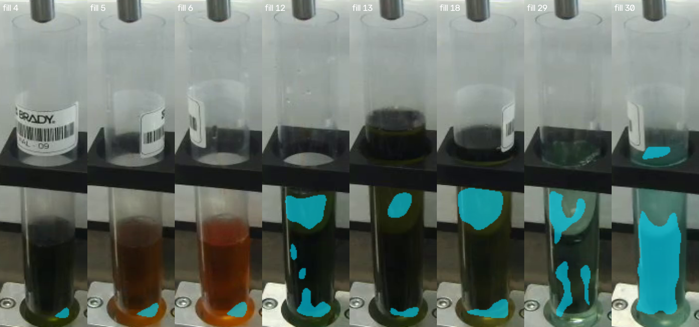
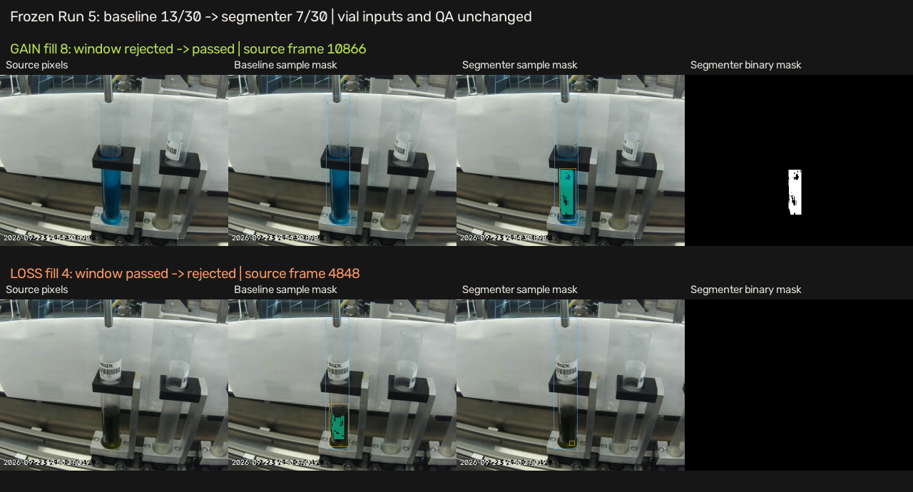
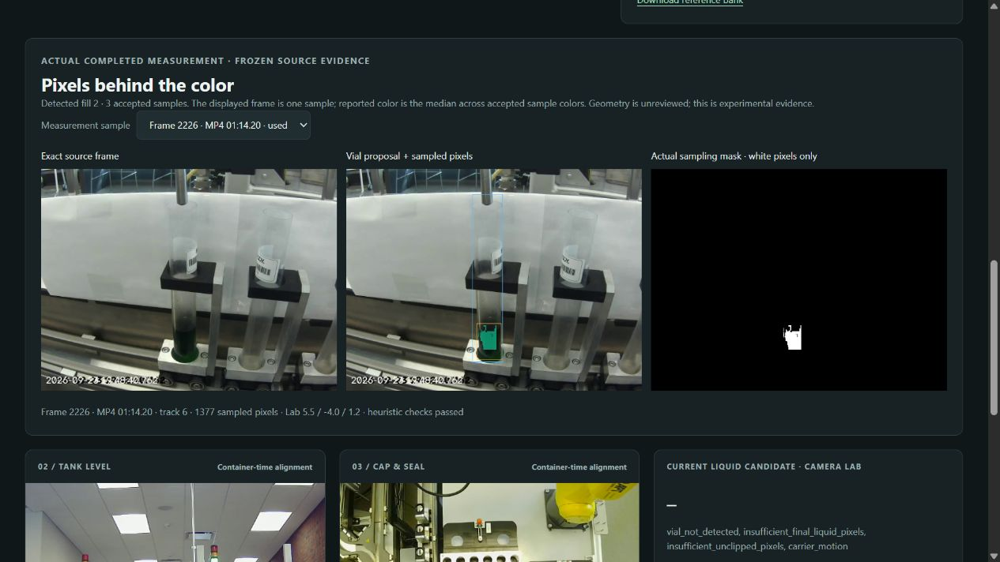

# Current milestone: box localization and tracking - October 19

See the [box-first plan](../../setup/vision/BOXES.md) and
[Run 5 review export checks](box-tracking-review-run5.json). The full recording
now has a separate source/box review video with frozen two-class detections and
candidate ByteTrack vial IDs, plus a 60-frame correction interface. All 8,491
raw detections and source hashes are preserved. This does not establish reviewed
box or physical-identity accuracy. Segmentation/color QA remains downstream;
the coverage numbers below are historical experiments, not localization scores.

The [cropped + CLAHE training comparison](crop-contrast-detector-run5.json) is
complete: Rosie job 285702, Runs 1-3 fit / Run 4 selects / Run 5 diagnostic only.
Overall provisional-box mAP50-95 fell from 0.6528 to 0.6214. Keep the original
detector. Local full-recording and native-rate early-pour videos, reproduction
and limitations are documented in [CROP-CONTRAST.md](../../setup/vision/CROP-CONTRAST.md).

# Segmentation adapter debug - October 19

The post-hoc [debug audit](segmentation-pipeline-debug-run5.json) fixes semantic
fragments being counted as independent liquid instances. Coverage becomes
**8/30**, up from 7/30; only fill 30 is recovered. The 13/30 baseline remains
recommended. Weights, crop transform, QA constants, all 30 events/tracks/windows
are unchanged. All 24 regression frames reproduce their original component
coordinates. All 90 measurement samples and 360 review PNGs pass the pixel/mask/
color audit. No foreground is added by postprocessing; trusted recipe results
remain unavailable. This is pipeline debugging after inspection of Run 5,
not another blind benchmark. See [reproduction and per-case findings](../../setup/vision/SEGMENTATION-DEBUG.md).
The [published-source checks](segmentation-pipeline-debug-source-checks.json)
record 45 passing replay tests, two setup tests, a working documented launcher,
and an exact source/mask/color match over HTTP for recovered fill 30.

# Original sampling segmentation experiment - October 19

The frozen candidate regressed to **7/30** QA-valid Run 5 windows versus the
**13/30 baseline**, with identical vial detections, tracks, fill events, windows
and QA settings. Keep the baseline. Runs 1-3 trained the model; Run 4 selected
the checkpoint; Run 5 was excluded from fitting/selection.

See [paired report](segmentation-run5.json) and
[reproduction](../../setup/vision/SEGMENTATION.md). The published source archive
passes 42 replay tests and two bootstrap tests. Ordinary runtime loads both
ONNX models without PyTorch.

# Current tracked-liquid correction — October 19

Start with [VISION.md](../VISION.md),
[Run 5 evidence](tracked-liquid-run5.json),
[training provenance](bootstrap-training.json), and
[teacher-box agreement](run5-teacher-box-agreement.json).
The fixed-patch measurements below are historical and do not validate liquid color.

The new complete replay has 30 detected fills, 13/30 heuristic measurement
windows passing, and 30/30 trusted assessments unavailable pending geometry
review. The explicit earlier-vial reference produces one diagnostic deviation
of 7.42 ΔE2000. Ninety measurement samples and 360 PNGs were audited for exact
source pixels, masks, colors and aggregates; the v2 review schema passes.
38 replay and one bootstrap split/augmentation test pass from the source archive.

# Replay verification

Current image-based detection: [October 18 results](fill-detection.md), including
Run 5 one-to-one matching and boundary timing. The notes below preserve the
October 16 annotation-guided baseline; it is now an explicit optional mode.

October 16, 2026, local Windows data environment from `setup/`.

All five vial-fill videos decoded completely. All 15 camera files were probed and
hashed. The batch pass produced 17,450 sampled feature records and 30 annotated
completed-vial observations. Run 5 had 18 observations pass the fixed pilot QA
policy and 12 unavailable observations. Runs 1–4 remain unlabeled, so their image
telemetry does not create guessed fill/recipe or defect records.

| Run | Frames decoded | Samples | Annotated observations | QA-valid observations |
| --- | --- | --- | --- | --- |
| 1 | 33,662 | 5,611 | 0 | 0 |
| 2 | 4,802 | 801 | 0 | 0 |
| 3 | 5,792 | 966 | 0 | 0 |
| 4 | 9,482 | 1,581 | 0 | 0 |
| 5 | 50,942 | 8,491 | 30 | 18 |

The first batch took approximately 37 seconds including decoding and extraction
on this machine. This is a local throughput measurement, not camera-to-alert
latency. Default no-reference decisions remain unavailable; this is intentional.

Thirteen regression tests passed, including synthetic future-frame changes that
leave earlier features unchanged, backward seeking, preventing current/future
references, source/profile mismatch, invalid-image rejection, annotation validation,
video HTTP ranges, publication timing, export cutoffs and configuration/override
validation. JavaScript syntax was
checked with Node; Node is not required to run the app.

The initial cache roundtrip check caught tuples becoming lists after JSON reload.
Configuration now exports JSON-compatible values so cached and fresh results agree.

Browser checks exercised three-camera playback and synchronized seeking, exact
vial navigation, completed-check jumps, reference publication, backward seeking,
unlabeled run switching and CSV download. At the checked paused point all three
videos reported the same 935.562216-second MP4 time with no media error. A CSV
download through frame 27,444 contained exactly 17 observations and none available
after that frame.

A manually selected development reference from vial 16 gave a 5.96 ΔE2000 review
for vial 17; returning to vial 16 remained unavailable, so its own reference was
not reused. This tests plumbing, not the correctness of either vial. That test
reference was moved into a separate verification output folder; the normal app
starts without a preselected development reference.

Browser testing caught stale recipe cards during run preparation, a seek before
metadata was ready and fractional-time rounding at annotation boundaries. Run
switches now clear old state, pending seeks wait for metadata, and programmatic
seeks land inside the requested frame. The rapid-switch walkthrough passed after
those fixes.

These are software and measurement-coverage checks. There are no independently
reviewed defect labels here, so no false-alert rate, recall or production-reliability
claim follows. The older analysis's measurement policy and scores are separate.
