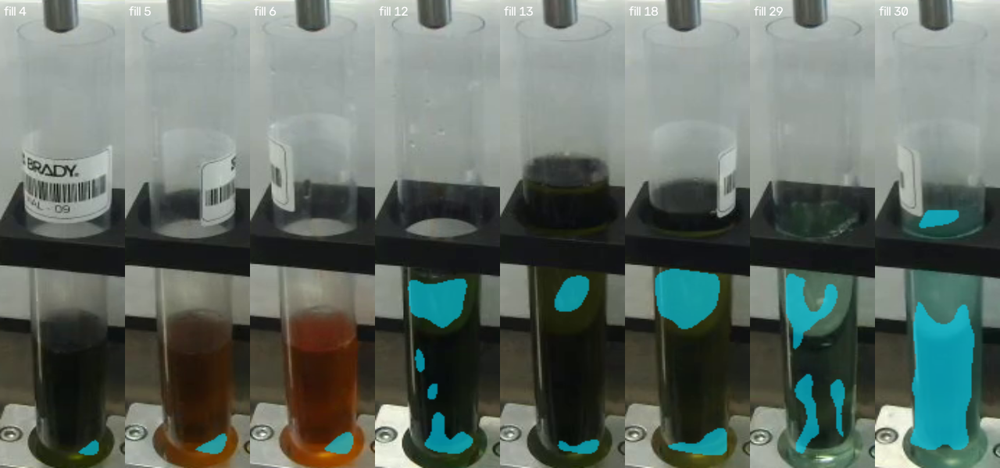

# Run 5 segmentation adapter investigation

This is post-hoc pipeline debugging of the eight regressions in the original
[7/30 experiment](../../replay/verification/segmentation-run5.json). Run 5 has
already been inspected; this is not another blind evaluation. The model weights,
checkpoint, probability threshold, crop transform and all QA constants stay
fixed. No retraining, selection of a checkpoint on Run 5, mask fallback, or
combination with the baseline mask is used.

The corrected candidate passes **8/30**, versus **7/30** before the adapter fix
and **13/30** for the box-guided baseline. Only fill 30 is recovered. There are
no new lost windows relative to the original segmentation candidate. Keep the
baseline; the segmenter remains an opt-in diagnostic experiment.

| Original regression | Corrected result | Evidence across all three samples |
| --- | --- | --- |
| Fills 4, 5, 6 | Rejected | Raw predictions have 102-227 pixels, all outside the allowed vial interior; zero survive even before extra proposal-border insets. |
| Fill 12 | Rejected | Coherent-area fraction 0.189-0.221, below the unchanged 0.35 floor. |
| Fill 13 | Rejected | Coherent-area fraction 0.117-0.137. |
| Fill 18 | Rejected | Coherent-area fraction 0.278-0.282. |
| Fill 29 | Rejected | Coherent-area fraction 0.149-0.158. |
| Fill 30 | Passes provisional QA | The upper false blob is excluded; coherent-area fraction 0.688-0.695 and 2,839-2,848 actual final sample pixels. |

All 8,491 baseline features reproduce exactly. All 30 events, vial tracks and
sample windows are identical across the control and corrected candidate. The
audit checked all 24 regression frames against their original component boxes
and source hashes, and all 90 window sample masks/colors/aggregates plus 360
review PNG hashes. No processing stage added model foreground. Both profiles
still return 30/30 trusted recipe results unavailable. These counts establish
reproducibility and unchanged QA, not reviewed segmentation accuracy.

The remaining issues are the model/target definition and incomplete raw
foreground, not a source crop offset. The corrected fragment adapter had been
masking those later QA failures. Reviewed outlines versus sampling interiors,
empty/clear/reflective negatives, and difficult colors remain inputs from the
label team before another training study.

The adapter incorrectly interpreted each connected fragment of a **binary
semantic sampling-interior map** as a separate liquid instance. A shadow or an
extra upper-vial blob could therefore reject a whole frame before the normal
physical exclusion mask ran. The corrected adapter supplies one semantic
proposal for the uniquely detected vial, preserving the original foreground and
holes. The existing physical/HSV filtering and largest-coherent-component
selection then run in their original order. Independently detected objects
remain subject to the original ambiguity rejection.

The 0.5 probability threshold and 60-pixel raw-component filter are unchanged.
All proposal-border insets (3/4/3/5 pixels), vial wall/base/upper exclusions,
opening and erosion, 60 final pixels and 0.35 coherent-area floor remain.
Motion, tracking, holder, clipping, sensitivity, temporal and three-sample
window requirements also remain. In particular, a tiny predicted base patch
does not become usable just because its model target was already inset.
Removing those safety margins would change the QA policy and is not part of
this correction. No missing foreground is filled in or propagated from another
frame.

Crop preparation and inference still share the same padding and RGB resize
helper. Tests check source-coordinate projection with offset and clipped-edge
crops, semantic fragments, exclusion of upper-vial pixels, unchanged instance
ambiguity and coherent-area rejection. Diagnostic frames retain the actual
128x384 RGB input and source-aligned probability map for inspection.



Cyan is the model foreground before physical/color QA, not a reviewed liquid
outline. The first samples of fills 4/5/6 predict only tiny base patches. Fills
12/13/18/29 contain disconnected upper/base islands and sparse interiors. Fill
30 contains a useful lower region plus an unwanted holder-level blob. The
source RGB crops and original retained-component boxes are reproduced exactly;
there is no evidence of an inference crop offset or channel swap in these
24 samples. Labels and mask correctness still require independent review.

## Reproduce

From the repository, after ordinary setup:

```powershell
$python = "$HOME/ai-club-tools/envs/data-windows/Scripts/python.exe"
$before = "$HOME/ai-club-tools/results/sampling-segmentation-20261019"
$debug = "$HOME/ai-club-tools/results/segmentation-pipeline-debug-20261019"
$sourceCache = "$HOME/ai-club-tools/results/tracked-liquid-20261019/cache/run5-8bdd8cad2977ee74e6a3.json"
& $python setup/vision/compare_sampling_segmentation.py --baseline-cache $sourceCache --recipe-plan replay/examples/run5-demo-plan.json --out $debug
& $python setup/vision/audit_segmentation_regressions.py --previous-study $before --current-study $debug
pwsh -File setup/run-replay.ps1 -Config "$debug/segmentation-reuse.json" -RecipePlan replay/examples/run5-demo-plan.json -Out "$debug/segmentation" -Port 8767
```

Use a new output root for a new investigation. The comparison recomputes the
whole Run 5 path from pinned image proposals and checks all source RGB hashes.
It asserts exact reproduction of the 13/30 baseline, identical vial tracks,
events and measurement windows, and the frozen QA configuration. Its historic
protocol hash identifies the unchanged weights/QA settings, not a claim that
this adapter correction was preregistered. Use `--data` if necessary. The audit
needs the preserved original experiment's comparison and source PNG exports;
it does not regenerate the old adapter result with the corrected code.

`comparison.json` gives all 30 paired decisions. The usual v2 annotation handoff
is `segmentation/run5/qa-review/manifest.json`. Optional segmentation evidence
inside each sample's `geometry` now includes:

- `proposals[].mask_target_kind`: `sampling_interior`; one conditioned semantic
  field, not full-liquid outlines or instance segmentation.
- `proposals[].crop_box`: source crop `[x0,y0,x1,y1]`, exclusive upper bounds.
- `proposals[].raw_components`: boxes and pixel counts of original retained
  connected fragments, before physical exclusions.
- `sampling_bounds`: the unchanged proposal/vial safety intersection; it may
  be empty and rejected.
- `mask_stages`: source-coordinate RLE masks at `model_proposal`,
  `physical_interior`, `hsv`, `opened`, `largest_component`, and `eroded`.
  Stages after an early rejection are absent. RLE uses the same origin/size/
  row-major foreground-run representation as the final mask.
- `mask_stage_pixels`: counts at available stages. `geometry.mask` and
  `mask_pixels` remain the **actual final measurement mask**, after clipping
  and luminance trimming; intermediate masks never supply the exported color.

`regression-audit/manifest.json` is the smaller diagnostic index for all eight
original regressions and their 24 measurement frames. It records source RGB
hash, zero-based frame and MP4 seconds, crop, components, sampling bounds,
per-stage counts, final QA status/reasons, and artifact paths/SHA256 hashes.
`coherent_area_fraction` uses the eroded mask before final luminance trimming
and the unchanged safety rectangle denominator; its required floor stays 0.35.
Artifact paths are relative to that manifest directory. Original source PNGs
are identified by `source_root` plus `source_image`. `*-probability.png` is a
16-bit source-sized image with probability multiplied by 65535, zero outside
the crop; it is a visualization, not a replacement inference input. The RGB
input crop and binary stage PNGs make crop/mask transforms directly reviewable.
`all-eight-regressions.png` shows each first sample; the manifest includes all
three samples per case. The audit additionally checks every one of the 90
measurement samples and all 360 review PNG hashes, exact masks/colors and
window aggregates, and that postprocessing never adds foreground.

Higher QA coverage does not establish mask precision or correct liquid color.
All geometry remains provisional, all trusted recipe assessments remain
unavailable, and this does not authorize release. Reviewed masks/windows and
hard negatives remain with the label team. The ordinary box-guided baseline
continues to be available independently through `bootstrap-vision.json`.
