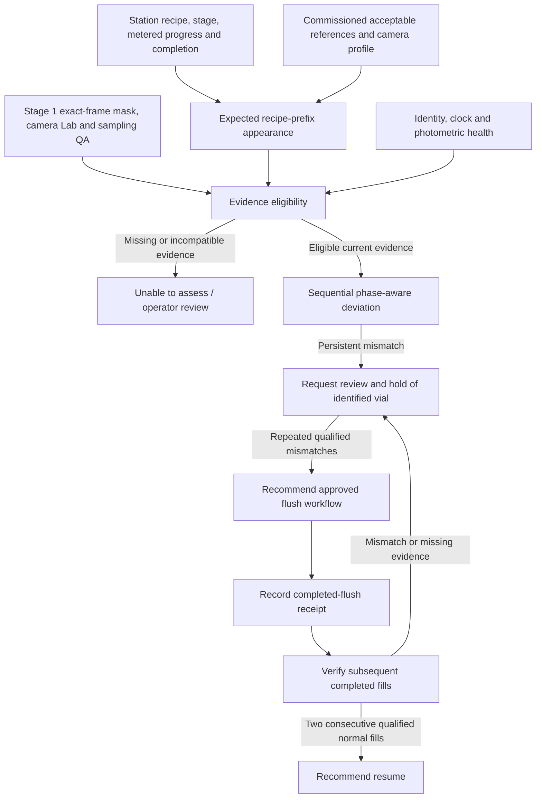

# Stage 2: recipe-aware changeover guard

October 20, 2026. **Offline experimental design, not a commissioned product-quality
system.** Work is on `austin-work`; no Stage 2 changes belong on `main`.

Stage 1 provides vial/liquid proposals, an experimental pool mask and sampling QA.
Stage 2 combines those observations with the station's intended recipe and actual
process progression, requests operator review when evidence persists, and tracks
recovery after an acknowledged intervention. Existing Teledyne inspection and
flow-meter dispensing remain independent inputs/controls.

## Architecture chosen from the experiments



CPU owns decoding, timestamps, process-context alignment, reference lookup,
sequential evidence, operator state and audit records. GPU inference remains the
existing YOLO11n vial branch, Faster R-CNN ResNet50-FPN liquid branch and SAM2.1
Hiera Tiny mask branch. This experiment adds no trained model. A language model
could summarize the evidence later; it does not choose thresholds or issue actions.

Expected appearance must follow the **current ingredient and cumulative delivered
volume**, including normal pauses and color evolution. Comparing an unfinished
mixture with the final recipe color is unsuitable. Current frame age, recipe
availability, reference provenance and measurement-profile compatibility must be
explicit. Physical vial identity must be established before a routing request.

There are two decision times:

- A qualified **phase checkpoint** can support an early advisory warning.
- Final recipe disposition requires an authoritative dispensing-complete signal
  and qualified evidence. Image stream-off alone can be an ingredient pause.

All requests remain advisory. A future CSI-approved adapter would translate them
into existing operator/PLC workflows and report acknowledgement, completion and
vial disposition. No hardware adapter, industrial connection or automatic release
was implemented.

## Real-video experiment: full Run 4

Frozen inputs: `vial_fill_video_4.mp4`, SHA256
`e2de9cdf613817556f3de1edaaf8e5aa4c998cdfdbb7c4c2cee2e76d672db1b9`.
All 9,482 native frames were decoded; every sixth frame was analyzed. The first
300 detector/SAM samples were reused after exact pixel/native-PTS checks and exact
measurement reconstruction. Only the remaining 1,281 samples required new GPU
inference. Checkpoints and measurements use no recipe labels or future frames.

| Metric | Result |
| --- | ---: |
| Analyzed frames | 1,581 |
| Image-detected completed fill candidates | 6 |
| Accepted sampling frames within detected fills | 849 / 931 (91.2%) |
| Existing completed-fill departure-window QA | 4 / 6 |
| Causal phase checkpoints | 9 |
| Fills with an earlier checkpoint in their final observed episode | 6 / 6 |
| Checkpoint lead before image-detected departure | 3.6–4.0 MP4 seconds |
| New-sample processing p50 / p95, excluding model-loading sample | 87.5 / 99.4 ms |
| Real recipe/quality assessments | 0: no eligible recipe/reference evidence |

The 931-frame denominator includes only the image-detected fill intervals, not
empty station time. Whole-recording sampling coverage is 849/1,581. Timing covers
the sampled processing path, not capture/network latency, full-rate 30 fps operation
or a production deadline guarantee. Five-Hz sampling also contributes sampling delay.

The existing window failed for candidates 2 and 6 near departure because of
motion/track/sample losses. Both had qualified earlier evidence. A new experimental
checkpoint takes three contiguous QA-passing same-track samples, after the image
detector has confirmed a pause and a further 0.5 seconds has elapsed; temporal
spread must remain within the existing 5 dE gate. Sampling gates are unchanged;
the checkpoint timing policy is new and opt-in.

The checkpoint generator emits on **every** qualifying ingredient pause. Three
checkpoints occur in intermediate episodes. The 6/6 final-episode count is a
retrospective opportunity analysis: the online generator does not know which pause
is final. Without a process-complete tag it cannot turn that count into six final
quality decisions. These six candidates lack independently reviewed identity,
onset, masks and defect outcomes.

## Controlled policy comparison

An analytic three-channel absorbance toy supplies known expected progression and
injected residual mixture. It is a software/decision fixture, not the mentees'
synthetic-image dataset, fitted fluid physics, or evidence of physical flush efficacy.
The same toy generates reference and observed colors; real domain mismatch is
not measured by this comparison.

The fixed grid contains 12 recipe profiles, three donor compositions, four nonzero
hold-up amounts (0.5/1/2/5 mL), two nuisance seeds and two availability schedules.
There are **624 simulated episodes and 3,744 policy evaluations**. Each availability
condition has 24 null and 288 injected episodes. Noise is paired across fault
severities. The second condition transplants real Run 4 QA schedules by normalized
cycle position; it is not real synchronized pump/video evidence.

The primary engineering settings were frozen before this comparison: dE2000 > 5,
three consecutive qualified samples, 0.4 s maximum sample age/gap. These are not
validated production limits. Thresholds 10 and 15 were included as sensitivity
arms; none was selected using Run 5.

| Policy | Null episodes flagged, ideal / Run 4 availability | Injected episodes warned, ideal / Run 4 availability |
| --- | --- | --- |
| Final-color reference on every frame, three samples | 24/24 / 24/24 | 288/288 / 288/288 |
| Phase-aware reference, single sample | 7/24 / 7/24 | 288/288 / 288/288 |
| Phase-aware reference, three samples | **0/24 / 0/24** | **262/288 / 254/288** |
| Completed-fill-only final reference | 0/24 / 0/24 | 65/288 / 64/288 |

With the transplanted QA schedule, the three-sample policy warned on 88.2% of
injected cases. Coverage by injected hold-up was 44/72, 68/72, 70/72 and 72/72.
Median warning delay was 0.5 simulated seconds after injected appearance onset,
including an assumed 0.1 s processing delay. Completed-fill-only warnings had a
15.7 s median delay among the cases they caught. The populations differ; this is
not a paired speedup estimate. The toy assumes accurate current process progression.

**These are injected-scenario warning rates, not real defect recall or accuracy.**
Any nonzero simulated residue is counted as an injection, even if its appearance
never exceeds the engineering threshold. No product tolerance or chemical purity
claim follows from these numbers. The two nuisance seeds and shared reference model
also do not support independent generalization confidence intervals.

## Reference and input robustness

A separate 192-evaluation stress experiment tested 24 null plus 24 two-mL injected
cases under four fixed reference conditions, using ideal sample availability.

| Condition | Null episodes flagged | Injected episodes warned |
| --- | ---: | ---: |
| Nominal phase/progress reference | 0/24 | 24/24 |
| Expected progression shifted forward one second | 24/24 | 24/24 |
| Unreported 10% green-channel gain | 24/24 | 24/24 |
| Expected optical density increased 10% | 0/24 | 24/24 |

The perturbations are engineering stress sizes, not estimates of plant uncertainty.
The first two failures establish concrete design requirements: obtain fresh
process-state/metering information rather than infer progression from wall time,
and commission a camera/reference health check before color deviation can cause
an operational request. Photometric drift detection/correction is **required but
not implemented or validated by this prototype**. Trusted process-state integration
is also not present. The nominal results must not be presented as deployment readiness.

Thirteen invalid-input conditions (65 samples) produced zero warnings: unknown
recipe/phase, unreviewed geometry, ambiguous identity, future recipe/reference,
wrong reference recipe/phase/profile, missing reference identity, invalid color,
failed QA and stale samples. An existing hold remains latched on missing evidence;
zero new warnings in a blocked case does not mean the product is acceptable.

## Action state and operator workflow

The proposed engineering policy requests review/hold on one sustained mismatch,
recommends a flush after two consecutive qualified mismatching completed vials,
and retains the hold until a recorded completed-flush receipt is followed by two
consecutive qualified normal completed vials. Missing evidence breaks the recovery
sequence. A receipt alone cannot clear the hold; duplicate vial completions cannot
count twice. A new source requires a new coordinator and explicit context.

The 44-second action video feeds logged simulated policy outcomes through this
coordinator: two injected vials, a simulated completed-flush receipt, then two null
vials. The same logged fixture is repeated within each pair. The fixture prescribes
zero residue after the receipt; no flush amount is optimized and no physical
intervention or independent recovery measurement is demonstrated.

Before physical use, CSI must confirm the actual recipe-selection source,
ingredient/metering tags, dispensing-complete signal, vial tracking/reject mapping,
allowed hold/flush boundary, execution receipts and feed/network arrangement.
Review/hold must fit the existing workflow rather than stop a pump mid-cycle.

## Artifacts and reproduction

Local root: `C:/Users/Austin/ai-club-tools/results/stage2-20261020`.

- `full-run4-v1/`: frozen plan/helpers, source-frame evidence, events, observations,
  timings and completion hashes.
- `evidence-audit-v1/`: checkpoint inventory, per-fill metrics and
  `run4-evidence-timeline.png`.
- `policy-simulation-v2/`: 624 episode fixtures, six policy arms, guard tests,
  `policy-comparison.png` and pinned code. The failed initial `v1` is preserved;
  it stopped on a vectorized-color conversion error before episode scoring.
- `reference-stress-v1/`: fixed clock/photometric/model stress cases.
- `demo-v1/`: `run4-evidence.mp4` (316.2 s),
  `run4-checkpoint-highlight.mp4` (23 s), and
  `simulated-action-loop.mp4` (44 s), posters and source-trace action derivation.
- `verification/`: final artifact audit and real-source policy abstention results.

Use `envs/vision-alternatives-windows/Scripts/python.exe`. All helpers refuse an
existing output directory. Full collection accepts explicit `--source`,
`--previous` (the causal-box comparison), `--original` (the first rendering),
`--experiment` (early-liquid), `--baseline`, `--sam` and `--out` paths.

```powershell
$vision = 'C:/Users/Austin/ai-club-tools/envs/vision-alternatives-windows/Scripts/python.exe'
$root = 'C:/Users/Austin/ai-club-tools/results/stage2-20261020'
& $vision setup/vision/analyze_stage2_evidence.py --input "$root/full-run4-v1" --out "$root/NEW-evidence-audit"
& $vision setup/vision/experiment_stage2_policy.py --real "$root/full-run4-v1" --out "$root/NEW-policy-simulation"
& $vision setup/vision/stress_stage2_policy.py --simulation "$root/policy-simulation-v2" --out "$root/NEW-reference-stress"
& $vision -m unittest discover -s setup/vision -p test_stage2_policy.py -v
```

Ten focused contract tests passed, including checkpoint prefix invariance and
pause-versus-completion separation. Three videos fully decoded: 1,581 + 115 + 220
frames. All 1,581 rendered real-source samples match source pixel hashes/native PTS.
See [executed verification](../verification/stage2-20261020.json).

The next real validation requires reviewed masks/timing and independent acceptable
recipe references, then supervised matched normal/carryover/flush trials with
actual process logs. Measure real unnecessary holds, missed unacceptable vials,
warning time before the routing deadline, unavailable coverage, and recovery cost.
Run 5 remains excluded from development choices and no real defect accuracy is
claimed here.
