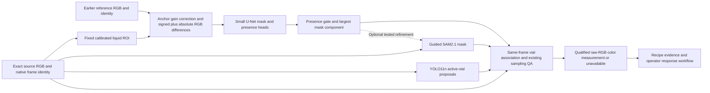

# Temporal pool candidate — development integration contract

**Download and start:** [October26 model/assets release and runnable example](../../team_handoff/temporal_cnn/README.md).
The example runs the liquid model only; vial association, measurement QA and the
operator application remain explicit integration responsibilities.

**October 24 decision:** the direct, SAM-free U-Net is the leading integration
candidate. SAM2.1 refinement is optional experimental work; DINOv3 remains a
comparator. See [the current architecture decision](CURRENT-ARCHITECTURE.md) for
model identities, application status and the validation still required.

The candidate in `temporal-pool-candidate.mp4` is a direct liquid-mask/presence
model trained from random initialization on synthetic scenes. It is the leading
experimental candidate from this round. The existing application is unchanged;
Srijan owns deciding how to integrate model modules into the team's pipeline.

**Matched follow-up complete:** [SAM/temporal comparison and refinement](SAM-TEMPORAL-COMPARISON.md).
Direct temporal is about 6× faster on identical inputs. An exploratory branch
uses temporal proposals to prompt SAM and raises QA-eligible samples from 105/264
to 185/264 (80 gains, zero losses), without R-CNN. It reuses cached upstream
inference; 72.62 ms is incremental refinement/QA timing, not a measured full
hybrid latency. Keep the fast direct option and test refinement for sampling;
human mask/onset accuracy and reference qualification remain pending.

## Actual processing path



The tested mask input is a **fixed station ROI**, not a YOLO-selected crop.
YOLO supplies same-frame vial proposals for association and QA. Changing to a
moving crop needs its own validation. Camera alignment and reference identity
are explicit dependencies, not properties learned by the model.

## Models and computation

| Component | Tested identity | Where it runs |
| --- | --- | --- |
| Vial detector | YOLO11n, synthetic CSI fine-tuning, generic COCO initialization | GB10 GPU |
| Liquid model | Custom GroupNorm U-Net, 16/32/64/128 channels, mask and presence heads; `paired_diff_gain`, selected epoch 40 of 60 | GB10 GPU |
| Reference preprocessing | RGB median anchor, clamped per-channel gain, signed difference and absolute difference | CPU anchor extraction and GPU tensor operations |
| Mask association/QA | Largest component, full-source coordinates, existing geometry and measurement checks | CPU |
| Operator actions | Existing advisory workflow and human response | Existing application; no equipment command |

The liquid input has six channels: three signed differences and three absolute
differences. This is a paired-frame model. Its earlier reference is supplied
explicitly; reference lifecycle is outside the network. A sigmoid presence
head and mask head each use a fixed 0.5 threshold. A liquid proposal requires
presence above threshold and a nonempty component. The mask directly supplies
the segmentation proposal; this candidate's liquid branch does not invoke
Faster R-CNN or SAM. The original detector/SAM architecture remains a comparator.

Model identity:

```text
Liquid checkpoint SHA256:
6714fe32191d8eba230aa87246f38a25c2906c619d60d7ba30c9e60205352eef

Vial checkpoint SHA256:
0bfac07a256eaf190416b632ad1f094a6b534309df1bb11a8c175e9d811b56bc
```

The liquid checkpoint and frozen architecture helper are retained locally under
`C:/Users/Austin/ai-club-tools/results/synthetic-iterations-20261022/gb10-results/`:
`masks-v1/paired_diff_gain/best.pt`, its `frozen-model.json`, and
`train_pair_masks.py`. The matching bytes also remain on GB10 under v1.
Full protocol, source boundaries and results: [SYNTHETIC-ITERATIONS.md](SYNTHETIC-ITERATIONS.md).

## Required input/output contract

| Field | Contract |
| --- | --- |
| Current image | Original decoded RGB, 640 × 480. Preserve its pixel hash. |
| Reference image | Same camera/geometry and full dimensions, with separate source identity and qualification status. Existing clip references remain unreviewed. |
| ROI | Source `[left,top,right,bottom] = [256,240,368,432]`, 112 × 192. |
| Gain anchor | Source `[32,160,80,208]`. Per-channel reference/current medians; gain clamped to 0.65–1.55. |
| Frame identity | Source-video hash, zero-based decoded index, native PTS/time base, decoded RGB hash. |
| Presence | Raw score and frozen threshold; score is not calibrated accuracy. |
| Mask | Raw model mask and accepted largest component, each mapped into original 640 × 480 coordinates; retain presence-gate result. |
| Geometry | Component box derived from the same-frame mask, plus actual same-frame vial proposals. |
| Measurement | Existing QA outcome/reasons and raw-source color measurement; never measure color from corrected difference features. |
| Provenance | Both model hashes, helper/config identities, reference identity/status and all source frame identities. |

Reference status must travel with predictions. A model's zero output on its own
reference image does not establish empty-vial truth. The development clips do
not provide an automatic reference acquisition/reset policy. Human confirmation
and controlled reference tests are part of physical-test readiness.

## Evidence and next gate

The six-clip video is promising visual transfer. Earlier unchanged-QA passes
were 105/264 frames; this is measurement availability, not mask or product
accuracy. Masks may be useful before color measurement is eligible. Keep those
two states separate in the operator display.

The fixed candidate completed synthetic stress tests, real-image prediction
stability tests and a complete cached-input CV benchmark on GB10. The CV path
measured 15.47 ms median / 24.53 ms p95 over 528 samples, excluding decode,
transport and browser. Final sampling masks, colors and QA outcomes reproduced
exactly in both passes. Digital darkening ×0.70 retains 0.993 mean mask consistency
with 2/264 proposal decisions changed. A later reference changes 126/264 decisions;
five-pixel reference shifts also degrade masks. Details and standalone plots are
in `candidate-summary-v1` under the experiment root.

Reference capture/reset and alignment checks therefore need explicit design
and validation before integration. Preserve reference identity/qualification,
invalidate it on vial/camera changes, and test those transitions. Do not use
the model's own negative output as proof that a reference is empty. These tests
do not change training, checkpoint selection or thresholds. Real perturbation
agreement measures sensitivity, not human accuracy. Physical lighting/camera
tests and the appropriate operator reference procedure remain necessary.

The [72-frame review packet](../../annotation_review/VISIBLE-POOL-REVIEW.md) is
ready for explicit human presence/mask/onset decisions. Reviewed real imagery
is evaluation-only. An independent raw-first subset helps check draft anchoring.
With completed exports, the scorer can report mask IoU/Dice, presence
precision/recall, uncertainty coverage and interval-valued first-visible delay.
Without them those accuracy fields remain unavailable.

No new physical session is booked by this experiment. Do not connect hardware,
industrial networks or cameras. Use approved files or the existing simulator
producer, and preserve the separate CSI booking/feed approval process.
