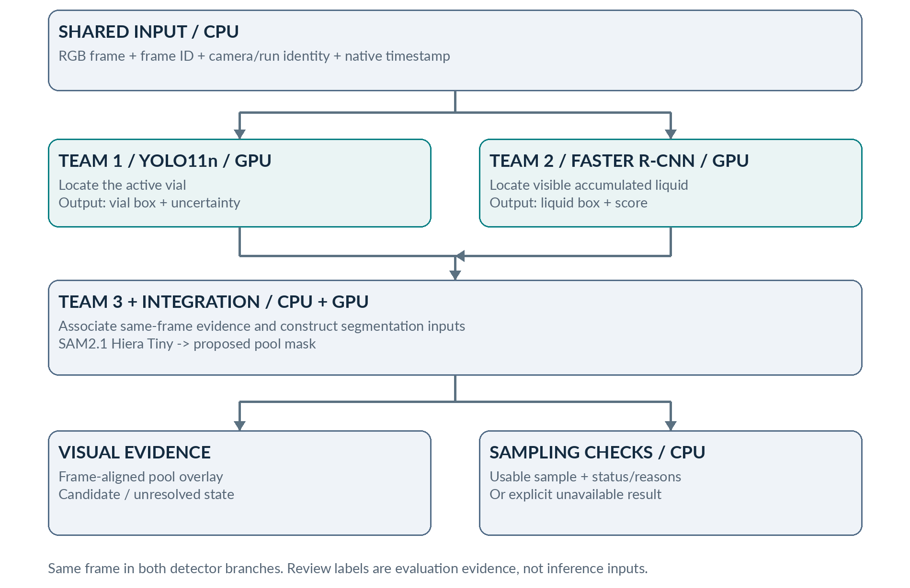

# Liquid vision team handoff

Dataset **`liquid-team-data-v1-20261020`** · [Download release v1.0.0](https://github.com/ALL-Applied-AI-Network/msoe-ai-club-rockwell-automation-nvidia-hackath-austin-koske-s-team-8e90f213c6/releases/tag/team-data-v1.0.0)

Build a pipeline that detects accumulated liquid as soon as it is visibly identifiable
at the vial bottom, produces a useful mask, and reports whether the image supports
a reliable sample.

## Start here

1. Read the [architecture implementation brief (PDF)](Team-Architecture-Implementation-Brief.pdf).
   It defines the three modules and their interfaces; your team designs and explains the implementation.
2. Read the [data guide (PDF)](Team-Data-Guide.pdf) for formats, provenance, splits and missing labels.
3. Download [Team-Core-Data.zip](https://github.com/ALL-Applied-AI-Network/msoe-ai-club-rockwell-automation-nvidia-hackath-austin-koske-s-team-8e90f213c6/releases/download/team-data-v1.0.0/Team-Core-Data.zip) (**281.3 MB**).
   It contains components 00–03 below, including both PDFs. You can start all three teams with this download.
4. Verify against [SHA256SUMS.txt](SHA256SUMS.txt) and extract outside the Git checkout.
   The shared top-level directory is `liquid-team-data-v1/`.

This is a private repository; sign in with a GitHub account that has repository access.
The team handoff and release data attachments include no implementation source,
weights, final-solution masks or detailed solution recipe. GitHub's automatically
listed source-code archives are repository snapshots, not the team data download.

## Three teams

| Team | Starting model | Responsibility | Start with |
| --- | --- | --- | --- |
| 1 | YOLO11n | Active-vial detection and geometry | Core: detector starter and vial source imagery |
| 2 | Faster R-CNN / ResNet50-FPN | Liquid localization, especially early shallow pools | Core: starter labels, COCO exports and vial source imagery |
| 3 | SAM2.1 / Hiera Tiny | Mask prompting/refinement and aligned integration | Core: source videos and 300 Run 4 development frames with machine boxes |

## Optional component downloads

Use the combined core **or** components 00–03; they contain overlapping files.
Extract any chosen component ZIPs to the same parent directory. Components 04 and
05 are separate additions and are not in the core.

| Archive | Size (decimal MB) | Contents |
| --- | ---: | --- |
| [00-team-guide.zip](https://github.com/ALL-Applied-AI-Network/msoe-ai-club-rockwell-automation-nvidia-hackath-austin-koske-s-team-8e90f213c6/releases/download/team-data-v1.0.0/00-team-guide.zip) | 1.7 | PDFs, architecture diagram, shared inventory and contracts |
| [01-detector-starter.zip](https://github.com/ALL-Applied-AI-Network/msoe-ai-club-rockwell-automation-nvidia-hackath-austin-koske-s-team-8e90f213c6/releases/download/team-data-v1.0.0/01-detector-starter.zip) | 121.0 | YOLO and COCO detection formats, run splits and translation ancestry |
| [02-vial-source-runs1-4.zip](https://github.com/ALL-Applied-AI-Network/msoe-ai-club-rockwell-automation-nvidia-hackath-austin-koske-s-team-8e90f213c6/releases/download/team-data-v1.0.0/02-vial-source-runs1-4.zip) | 92.6 | Original vial images and four source videos, machine annotation exports |
| [03-sam-frames-run4-development.zip](https://github.com/ALL-Applied-AI-Network/msoe-ai-club-rockwell-automation-nvidia-hackath-austin-koske-s-team-8e90f213c6/releases/download/team-data-v1.0.0/03-sam-frames-run4-development.zip) | 66.0 | 300 source-aligned PNGs, native PTS/frame identity and machine box proposals |
| [04-other-cameras-runs1-4.zip](https://github.com/ALL-Applied-AI-Network/msoe-ai-club-rockwell-automation-nvidia-hackath-austin-koske-s-team-8e90f213c6/releases/download/team-data-v1.0.0/04-other-cameras-runs1-4.zip) | 245.5 | Optional tank/cap camera context with camera-specific class maps |
| [05-run5-diagnostic-only.zip](https://github.com/ALL-Applied-AI-Network/msoe-ai-club-rockwell-automation-nvidia-hackath-austin-koske-s-team-8e90f213c6/releases/download/team-data-v1.0.0/05-run5-diagnostic-only.zip) | 391.2 | Optional inspected diagnostics; keep separate from model development |

Exact archive sizes, file counts and hashes: [archives.json](archives.json).
Checksums cover all seven ZIPs and both standalone PDFs.

## Formats and evidence

- **Training: Runs 1–3. Development: Run 4.** Run 5 has already been inspected:
  use it only for diagnostics, never fitting, checkpoint selection, threshold tuning
  or sampling decisions. This package does not provide a blind final test.
- The default vial starter has **721 original training images and 157 development
  images**. A separate historical profile includes **1,442 training samples** with
  existing translated copies; these are not 1,442 independent originals.
- YOLO labels use normalized center/width/height coordinates. The vial starter
  remaps vial to class 0 and preserves original two-class files separately.
  COCO exports use pixel XYWH boxes. The PDFs specify each module's interface.
- Existing machine boxes are **unreviewed suggestions**. Missing liquid labels are
  provisional negatives, not confirmed-empty frames. Legacy liquid boxes may
  include the stream and are not approved accumulated-pool annotations.
- The full optional collection has **4,647 indexed stills, 15 source videos and
  16,814 exported provisional boxes**. Twenty-one vial stills require manual review.
  No approved liquid masks, first-visible onset labels or track identities are supplied.
- Do not infer video frame indices from still capture timestamps or assumed 30 fps.
  The SAM starter has explicit decoded frame indices/native PTS; still/video
  associations remain unmatched unless separately reviewed.

Original data and labels remain intact. Aleyna, Zoe and Reagan own approved
spatial labels and timing decisions; keep reviewer exports separate and preserve
provenance. Source imagery, model weights and reviewer workspaces stay out of Git.

## Team implementation

The architecture brief defines the modules and shared interfaces. Each team
chooses, implements and explains its approach, then integrates frame-aligned
outputs with the other teams. Use a separate branch for your implementation work.

Publish future data revisions as new versioned release assets rather than
replacing evidence underlying existing reviews. Keep downloaded datasets, weights
and reviewer workspaces outside the Git checkout.
