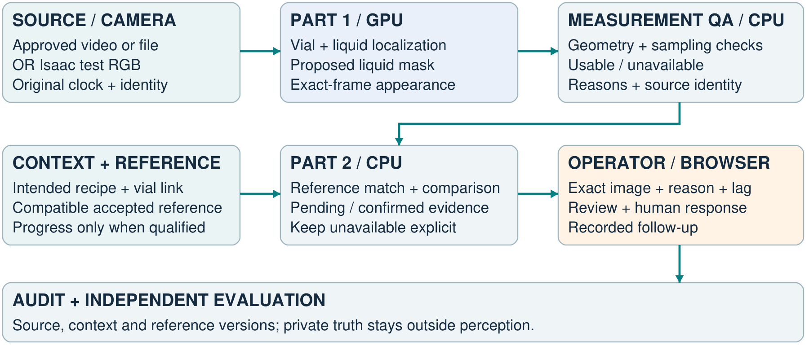
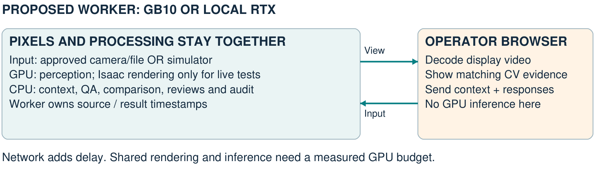

# Part 2 — Recipe-aware operator assistance

Team architecture release v2 · October 22, 2026 · Meeting edition · Architecture and deliverables only

This extends the Part 1 team handoff. Existing YOLO, liquid-localization and segmentation assignments continue. Part 2 owners are proposed workstreams for discussion, not new assignments. This document contains no implementation source, weights, training examples or implementation answer key.

## 1. What we are building

### The explanation for the room

Part 1 finds the vial and visible liquid and proposes a mask. Part 2 asks whether that measurement is usable and whether the observed appearance agrees with the intended recipe. When qualified evidence disagrees, an operator sees the captured image, the reason and the context, then responds through the existing approved workflow. The digital twin lets us exercise this behavior before supervised physical testing.

### Why this adds value

Recognizing a familiar color is different from checking the intended recipe. A vial can resemble a known color without being the requested mixture. Recipe identity must come from the job or operator, not from the image. Appearance is an inspection signal; it does not uniquely determine chemical composition or certify product quality.

### Confirmed operating boundary

The hackathon system provides operator advice. It does not communicate directly with existing line sensors or actuators, update the Teledyne database, or execute a physical flush or sort. PLC integration is a possible later project. Approved video access, human actions and physical acceptance remain with CSI and the established station workflow.

## 2. Components and shared information

### The processing boundary

**GPU:** Part 1 perception currently uses YOLO11n vial proposals, Faster R-CNN with ResNet50-FPN liquid proposals, and SAM2.1 with Hiera Tiny mask proposals. Isaac Sim uses the GPU when generating test images. These are the current experiment components; teams still need to explain and validate their own implementations.

**CPU:** frame/context association, measurement eligibility, compatible-reference lookup, color comparison, sequential evidence, operator workflow and audit. Part 2's baseline needs no additional trained neural model. The browser presents video, timestamped evidence and human controls; it is not the inference worker.

| Connection | Information the receiving module needs |
| --- | --- |
| Frame to Part 1 | Image, camera/source identity, original frame clock and image provenance. |
| Part 1 to Part 2 | Visual track, liquid/mask proposal, sampled appearance, usable/unavailable reasons, exact source frame and model/profile identity. |
| Context to Part 2 | Intended recipe/version, confirmed physical vial association and completion; phase and actual progress only when independently available. |
| Reference to comparison | Compatible recipe, camera/measurement profile, expected endpoint or supported trajectory, version and independent acceptance evidence. |
| Part 2 to operator | Current evidence state, deviation or unavailable reason, captured frame, source time, confirmation status and review identity. |
| Operator to journal | Attributed acknowledgement, what the person actually did, follow-up observations and unresolved uncertainty. |

### Two operating modes

**Physical MVP:** approved video or exported recordings, operator recipe/vial context, human-confirmed dispensing completion and independently acceptable completed-fill references. Compare completed endpoints. During-fill recipe assessment stays unavailable without qualified phase/progress evidence; planned volumes and elapsed time are not actual delivered volume.

**Instrumented twin:** simulated recipe, phase and metered progress can support an evolving expected-color trajectory. Private composition and geometric truth stay with the evaluator, outside perception and reference selection. A detector counter is not a physical vial ID; video time is not automatically the process clock.

## 3. What the operator sees and does

### A continuous station, not a scripted walkthrough

The current local station receives frames and runs the existing CV/QA automatically. The operator watches the feed, supplies context, reviews captured exceptions and records a response while observation continues. The test source can be live Isaac rendering or pre-rendered Isaac video with actual live CV. A future approved camera adapter replaces the test source at the same frame-input boundary.

| Display state | Meaning and expected behavior |
| --- | --- |
| Measurement unavailable | A required check or input failed. Show the specific reason and actual image; do not substitute a successful assessment. |
| Within development band | This qualified sample agrees with an uncommissioned development reference. It is not a product-release decision. |
| Outside band; confirmation pending | This qualified reading exceeds the development threshold. Show it immediately while collecting the required persistent evidence. |
| Appearance differs; review required | Qualified persistence confirmed a deviation. Retain its captured evidence and review requirement when later samples fail QA. |

### Human response sequence

**Observe → inspect captured evidence → acknowledge review → record the actual human action → inspect distinct subsequent completed vials → document follow-up.** An acknowledgement is not an action. An action receipt is not proof of recovery. Closing a review does not authorize product release.

Recipe assessment, observed station route and human disposition are separate records. The supplied descriptions of the physical good/scrap destinations conflict; confirm the mapping on site instead of interpreting a destination label as ground truth.

### Make timing visible

The playing camera view and latest analyzed mask have separate timestamps. A mask belongs to its exact source frame, never a newer video frame. Current video can advance while CV works on a sample. Show analysis lag, missing masks and stale input explicitly. The sampled mask is visible by default beside the video on desktop and below it on mobile.

## 4. What the experiments actually established

All results below are development evidence. Analytic episodes, rendered RGB studies, real recordings and interface checks answer different questions. None establishes real recipe-defect accuracy.

| Evidence | Result and implication |
| --- | --- |
| Analytic simulator, fresh seeds | 0/24 normal episodes warned; 72/72 two-mL injections and 45/72 half-mL injections warned. These are complete episode counts, not frame counts. Smaller perturbations remain a weakness. |
| Actual Isaac perception study | 21 trajectories / 803 RGB-to-model frames. Adaptive replay with correction before perception warned on 0/10 nominal and 5/6 residue cases; all 16 had comparisons. The half-mL-equivalent case was missed. This adapted replay is not held-out validation. |
| Original Run 4 camera replay | Raw and corrected arms each passed sample QA on 849/1,581 attempts, with six gains and six losses. No aggregate QA gain; retain raw input as the physical baseline. This is coverage, not mask accuracy. |
| TensorRT candidate | Earlier matched Run 4 benchmark: median decode plus processing 89.48 to 83.22 ms, about 7% less time. One sample-QA decision differed in 1,581 frames. This is not current dashboard latency or a GB10 benchmark. |
| Continuous operator station | Actual CV, exact source/mask evidence, retained reviews and human response records work locally. The visibility check observed 173 live samples, including pending deviations and confirmed alerts retained on failed-QA frames; 26 focused tests passed. |
| Pre-rendered input | A 651-frame Isaac clip plays at 30 fps for 21.7 s. In a short browser check, 90 frames played in 3.01 s while CV processed 11 samples. Video playback rate and analysis throughput are different measurements. |

### Current choices and remaining gaps

Keep the frozen raw-input baseline and explicit QA. Treat TensorRT as a candidate requiring output review. Keep Cosmos Transfer/Reason outside the operational decision path: the completed Transfer trial changed liquid/color content and does not support automatic label inheritance. No reviewed early-liquid onset/mask accuracy or independently validated real recipe accuracy is available yet.

The current live prototype is not a commissioned station. A development color threshold, hypothetical residue amount or simulated purge volume is not a physical product tolerance or approved operating procedure.

## 5. Three proposed Part 2 workstreams

All streams can start with explicitly simulated fixtures while physical inputs are arranged. Agree owners and shared evidence examples in the meeting. Preserve the existing Part 1 model teams; these streams describe the integration work around their outputs.

### A — Context and acceptable references

**Deliver:** a clear association among physical vial, intended recipe, source clock, completion and compatible reference. Start with completed-fill endpoints for physical mode; add phase/progress trajectories only where the evidence supports them.

**Need:** recipe definitions, operator context, reviewed vial/clock links and independently acceptable references. Supplied recipe setpoints and timing labels are useful context but are not actual flow-meter logs or independently accepted reference samples.

**Show:** a supported recipe works; unknown recipe, wrong vial/profile, stale context or missing reference returns an explicit unavailable state. Explain how references are separated from evaluation cases.

### B — Qualified comparison and evidence state

**Deliver:** the Part 1 observation adapter, compatible feature comparison and per-vial evidence state. Keep sample QA, missing-data behavior, frame identities and reasons visible. Preserve review requirements across later unavailable samples.

**Need:** exact-frame RGB/mask/QA observations from Part 1 and compatible context/reference records from A. The team owns the algorithm choices, timing assumptions and evidence that justify them.

**Show:** evolving nominal appearance, persistent mismatch, a brief artifact, missing geometry and vial/phase boundaries. Report every attempted case, including misses and unavailable evidence.

### C — Operator experience, twin and integration tests

**Deliver:** the connected operator view, attributed review/action history and scenario runner. Coordinate a single end-to-end demonstration and latency report, not three disconnected model demos.

**Need:** A/B outputs, approved human-response definitions and a clear test-source contract. Cameron/Hayden retain synthetic rendering ownership; Aleyna/Zoe/Reagan retain approved label and timing review responsibilities.

**Show:** an exception reaches the operator with its exact image; a human response is recorded; distinct subsequent vials provide follow-up evidence. No procedure is executed by a UI entry.

### Meeting exit decisions

Choose an owner for each stream, agree the observation/context/reference handoff, select one shared nominal and one mismatch scenario, and decide the first integration checkpoint. Deliver architecture explanations and evidence with each component, not just a running screen.

## 6. Digital-twin testing and the CSI visit

### Use the twin as a controlled test source

**Scenario → simulated process/camera → public RGB and declared process cues → actual Part 1 → Part 2 → operator evidence and journal.** Keep private composition/geometric truth only on the evaluation side. A test harness may apply a separately tagged hypothetical simulated action; this does not authorize a physical action or establish physical calibration.

| Test family | Required observation |
| --- | --- |
| Nominal recipe and changing flow/pauses | Evolving color is not automatically an error; check reference eligibility and coverage. |
| Strong and weak residue/changeover | Report warnings, misses and unavailable cases against independent scenario identity. |
| Lighting, glare, occlusion and missing masks | Separate camera/geometry failure from mixture evidence; unavailable is a valid result. |
| Wrong/stale context, clock gaps and vial transitions | Refuse unsupported associations and stop evidence carrying across unrelated vials. |
| Response and follow-up | Preserve the original warning; evaluate distinct subsequent completed vials after an independently documented action. |

### Before the proposed October 26–28 visit

Confirm the CSI-supervised slot, attendees, approved video/export arrangement, allowed human responses and physical routing semantics. No booking or live industrial connection is documented. Bring original-recording capture/storage, source-clock inventory and recipe/vial/outcome forms. Default to approved recording export if a live feed has not been approved.

Collect independently acceptable complete fills for references, then separate prospective evaluation fills. Prioritize physical vial identity, recipe/completion context, original timestamps and independent outcomes. Request process-log exports only if CSI can provide them. Reserve independent validation cases before inspecting their scores; changed designs need fresh validation cases.

### Metrics we need

Report usable samples and completed endpoints over all attempts; warnings among independently unacceptable vials; warnings among independently acceptable vials; warning time relative to the confirmed human-action deadline; capture-to-display lag and dropped samples; and independently assessed follow-up outcomes. Report reviewed onset delay and mask quality separately for Part 1. Missing truth means the corresponding accuracy metric is unavailable.

Runs 1–3 remain training, Run 4 development and Run 5 diagnostic-only. Existing machine labels do not become human-approved labels. This brief authorizes no new real-data training or physical procedure.

## 7. Local compute, the GB10 and the next checkpoint

### Proposed remote layout

One worker owns frames, inference and Part 2. The browser receives timestamped video/results and sends human context/responses. An approved camera/file source replaces Isaac in physical mode.

GB10 supports the tested 5 Hz CV profile; high-quality live rendering is the bottleneck. The experimental worker is not deployed.

### Measured October 22

Same 111 pinned input frames and model/QA settings; one full warm-up plus 222 measured samples per processing arm. These compare the tested Windows/CUDA 12.8 and Linux/CUDA 13.0 systems, not hardware alone.

| Timed path | Median result |
| --- | --- |
| Existing loopback HTTP path | Local 272 ms; GB10 130 ms. |
| Persistent inference worker candidate | Local 148 ms; GB10 120 ms. Same-mask and QA agreement within each machine on all 222 measured samples. |
| GB10 live render plus inference | 485 ms per step; 1.81 processed frames/s at the tested render settings. |

The VPN/browser probe measured 556 ms median / 675 ms p95 from scheduled source time to loaded overlay. It acknowledged 93/111 inputs: 17 skipped and one left at clip end; 84 unique results appeared in the browser. This includes PNG upload, inference, polling and image loading, not physical camera/display latency or 30 fps video streaming.

### Deployment choice

Prefer pre-rendered test input or an approved camera/file source beside the worker. Validate drops and warning timing before promotion. Cross-machine sample QA agreed on 222/222 pairs; six masks differed slightly. This is numerical agreement, not reviewed accuracy.

### Evidence and references

Project evidence: the refinement, twin, acceleration, CSI-preparation, station and GB10 reports in setup/verification. Access boundary: OPERATOR-CLARIFICATION.md. Real recipe-defect accuracy remains unavailable.

Official hardware context: [NVIDIA DGX Spark hardware](https://docs.nvidia.com/dgx/dgx-spark/hardware.html). Performance guidance: [NVIDIA Isaac Sim optimization handbook](https://docs.isaacsim.omniverse.nvidia.com/latest/reference_material/sim_performance_optimization_handbook.html). Event context: [MSOE MAIC hackathon library](https://msoe-maic.com/library/?nav=Competitions&article=Rockwell-NVIDIA-Fall-2026).
