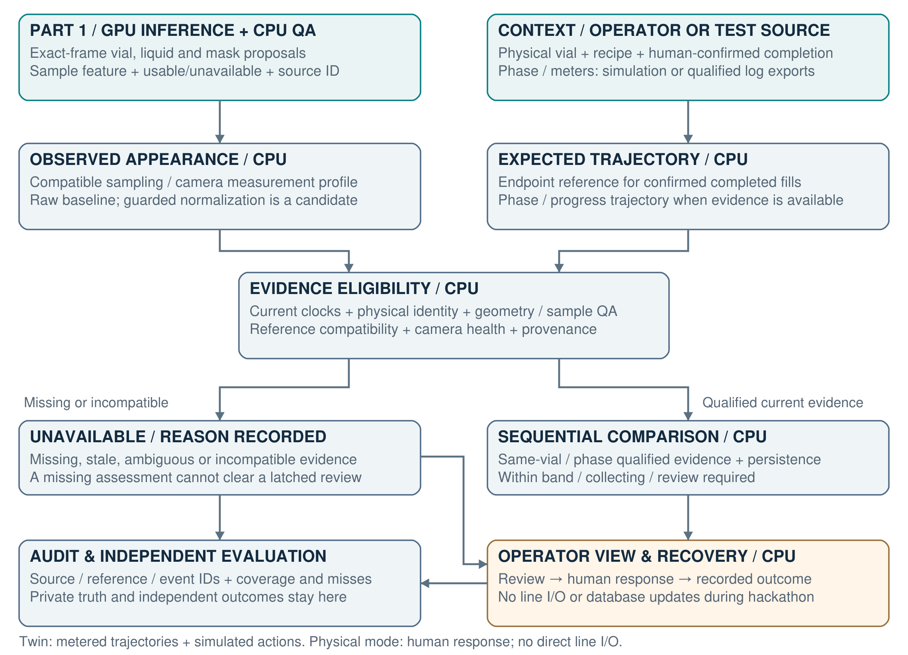

# Part 2 — Recipe-aware inspection and operator response

Team implementation brief · October 21, 2026 · Architecture proposal informed by completed development experiments.

**October 22 meeting edition:** read [the updated team architecture release](MEETING-20261022.md)
for the continuous operator interface, current evidence, three proposed workstreams,
digital-twin/CSI checklist and candidate GB10 deployment. Its seven-page PDF and
code-free sharing ZIP are prepared locally under
`results/part2-team-release-20261022/release-v2`; page 7 now includes matched GB10,
worker, rendering and VPN/browser measurements. The original `release-v1` is
preserved. Neither version has been published to GitHub.
This October 21 brief and its prior distributed packages remain historical context.

This extends the [Part 1 handoff](../README.md). The local PDF and code-free sharing ZIP are built separately; this document has not been published as a GitHub release. Existing Part 1 team assignments continue.

## 1. From visible liquid to an actionable warning

**Goal:** determine whether an identified vial's observed liquid appearance agrees with its **intended recipe at the current dispensing progress**, then present qualified evidence to the operator before the existing routing/review deadline.

Part 1 supplies geometry, mask proposals and sampling QA. Part 2 adds recipe context, acceptable references, comparison and operator review. The baseline requires **no additional trained neural model**.

**Physical MVP:** use CSI-approved video, operator-entered recipe/batch context and confirmed vial identity. Compare completed fills with verified endpoint references after operator-confirmed completion. Keep during-fill recipe comparison unavailable without qualified phase/progress evidence; planned quantities and elapsed time are not actual metering.

**Compute boundary:** Part 1's YOLO11n, Faster R-CNN / ResNet50-FPN and SAM2.1 / Hiera Tiny inference use the GPU. Part 2 alignment, feature checks, reference lookup, evidence state, operator workflow and audit run on the CPU. Isaac Sim renders test RGB on the GPU; it is a separate test source, not the plant controller.

**Confirmed boundary:** no direct line sensor/actuator communication or Teledyne database updates during the hackathon. The UI requests operator review and logs actual human actions. PLC integration is a post-hackathon possibility.

## 2. Shared interfaces and decision meaning

These are design contracts for the team to implement. Existing experimental logs need explicit adapters; a matching field name alone does not establish compatible meaning.

| Interface | Required information |
| --- | --- |
| Stage 1 observation | Session/camera/source hash; decoded frame, native PTS/time base; visual track; proposed mask and sampling region; observed color; geometry-review provenance; usable/unavailable state and reasons; model/config IDs. Preserve full-image coordinates from Part 1. |
| Process context | Physical vial/track link; intended recipe/version; phase, actual per-fluid meters and completion when independently available; native clock and mapping uncertainty. Physical MVP uses attributed operator recipe/completion entry; no direct sensor access. Missing progress stays unavailable. |
| Reference profile | Recipe/version, phase, camera and measurement-profile IDs; supported progress range and interpolation limits; expected color trajectory; preparation/acceptance evidence; reference ID/version and when it became available. Simulated and commissioned references remain distinct. |
| Qualified comparison | Matched observation/context/reference IDs; observed and expected color in the same feature profile; camera, geometry, sample and clock eligibility; deviation score or explicit unavailable reason. Preserve raw and corrected pixel identities if preprocessing is used. |
| Advisory event | Physical vial/session, source and decision times, eligibility, evidence IDs, reason, warning state and actionable deadline when known. Within-band evidence is an observation, not a product-acceptance certificate. |
| Operator/recovery record | UI review request, human acknowledgement, approved action, actual completion and assessed subsequent vials. Store recipe assessment, reported route, fixture label and operator disposition separately; confirm physical good/scrap semantics with CSI. |

### Four assessment states

**Unavailable:** a required input is missing, stale, mismatched or unreviewed. **Within expected band:** current qualified evidence agrees with its reference. **Collecting evidence:** deviation exists but persistence is insufficient. **Review required:** persistent qualified mismatch; retain that review requirement until the recovery workflow resolves it. Later missing evidence must not silently clear a warning.

### Two independent clock and identity problems

Native video PTS identifies the frame; reviewed anchors connect it to the process clock. A visual track identifies image continuity; a separately confirmed association connects it to a physical vial. Never derive recipe identity from color, process progress from assumed FPS, or a physical vial ID from a detector counter. An ingredient pause is not authoritative dispensing completion.

Fresh-looking metadata does not establish correct alignment. Validate the actual context against independent landmarks; matching appearance cannot uniquely identify ingredient composition.

## 3. What the experiments support

All figures below are development evidence. Read each denominator and test type; none establishes real defect precision/recall.

| Experiment / result | Architecture decision |
| --- | --- |
| Analytic flow variation, ±20%: clock template warns on 20/24 normal episodes; metered reference warns on 0/24. A phase-endpoint target warns on 24/24 normal episodes. | Use recipe + phase + actual delivered progress. Reference the changing mixture within a phase; avoid clock-only and final/endpoint-color comparisons. |
| Controlled transforms of real pixels, fixed model masks: encoded +10% green gives p95 paired color distance 5.22 raw → 0.68 with background correction. Models were not rerun. | Treat camera health and feature-profile compatibility as explicit inputs. Background normalization is a candidate robustness layer, not proof of absolute color accuracy. |
| Combined analytic simulator, fresh seeds: 0/24 normal episodes warned; 72/72 two-mL injections and 45/72 half-mL injections warned. All 168 episodes had assessable samples. | Metered references + camera/input guards + persistent evidence are the selected development direction. Small perturbations remain a known weakness. Injection size is not a product tolerance. |
| Isaac study: 21 trajectories / 803 actual RGB-to-model frames. Adaptive replay on corrected saved RGB: 0/10 nominal and 5/6 residue cases warn; all 16 have comparisons. Half-mL-equivalent case is missed. | Use the live twin to test actual perception and eligibility failures. This replay adapted to observed failures and is not a held-out result. Correcting color after masking cannot recover a missing mask. |
| Original unmodified Run 4: 1,581 attempts, 1,533 camera-eligible pairs; 849 QA passes per arm, six gains/six losses. Candidate unavailable: 25 startup + 23 unhealthy-anchor samples. | Keep raw input as the physical-test baseline. Upstream correction stays opt-in; there is no aggregate QA gain on this recording. Onset and mask accuracy still need reviewed labels. |
| Full sampled pipeline: TensorRT median 89.48 → 83.22 ms; one QA decision differs in 1,581 samples. Transfer trial invents liquid/colors and QA availability falls 24/29 → 17/29. | TensorRT remains an optional acceleration candidate. Cosmos Transfer/Reason are excluded from the decision path and automatic training-label inheritance. |

### Starting settings, not production limits

The policy prototype uses color distance **dE2000 > 5**, **three consecutive qualified samples**, and **0.4 s maximum age/gap**. Twin interpolation stays within a phase and supported range, with a tested 2.5 mL maximum reference gap. These are engineering settings from the experiments; commission tolerances and timing on separate reference data, freeze them before prospective scoring, and justify any changes.

**Known input failure:** wrong process progression falsely timestamped as current still causes warnings on 24/24 normal simulated episodes. Freshness checks cannot establish that the recipe/progress association is true; the physical test must verify those links independently.

## 4. Three implementation workstreams

This is a proposed division for Part 2, with owners to be agreed. It does not reassign the existing YOLO/liquid/SAM work or the data team's label/timing decisions. All workstreams can start with explicitly simulated fixtures while CSI inputs are being arranged.

### A — Process context and acceptable trajectories

**Build:** operator context/completion entry, reviewed clock/vial associations and versioned acceptable references. Start physical evaluation with completed-fill endpoints; support phase/progress trajectories in simulation or qualified offline logs. Match camera/measurement profiles and references available before evaluation.

**Need:** recipe definitions, operator-attributed context/completion, physical vial links and verified acceptable references. Actual logs/clock landmarks are optional CSI exports, not a promised live sensor feed. Supplied setpoints/timing labels are not actual meter logs or reference-preparation evidence.

**Demonstrate/explain:** correct lookup during variable flow and pauses; unknown recipe, wrong phase/profile, stale/future context, meter resets/out-of-range and missing references all remain explicit. How will you validate the adapter and choose interpolation limits without using observed color to find a favorable reference?

### B — Measurement eligibility and sequential comparison

**Build:** the Stage 1 adapter, camera/profile checks, qualified color comparison and per-vial evidence state. Preserve existing sampling QA. Reset consecutive evidence across invalid samples, long gaps, phase or vial changes; preserve a latched review requirement appropriately.

**Need:** exact-frame RGB/mask/QA observations, geometry-review provenance, compatible reference/context records and raw camera/background samples. Human onset/mask reviews remain separate evaluation truth; machine proposals cannot approve themselves.

**Demonstrate/explain:** nominal evolving color, persistent mismatch, a brief artifact, missing geometry, anchor occlusion and a vial transition. Compare raw baseline with any correction candidate using matched source frames. How will you distinguish wrong mixture from local lighting/refraction, and expose cases you cannot resolve?

### C — Operator workflow and twin test integration

**Build:** one evidence view, auditable advisory events, simulated operator receipts/recovery verification and the scenario runner. Show intended recipe, current phase/progress, evidence availability, warning reason and relevant frame; display unknowns explicitly.

**Need:** outputs from A/B, physical workflow/deadline confirmation, approved intervention definitions, independent subsequent-vial outcomes and public simulator RGB/process cues. Coordinate renderer/appearance changes with Cameron/Hayden; approved labels/timing remain with Aleyna/Zoe/Reagan.

**Demonstrate/explain:** review requested → human response → recorded actual action → verification on distinct subsequent completed vials. A flush receipt alone cannot establish recovery; duplicate events cannot count as independent confirmations. No station adapter or database updates during the hackathon.

## 5. Integration, digital twin and the physical test

### Keep the twin inside the engineering loop

**Scenario runner → simulated plant/camera → public RGB + process cues → unchanged Stage 1 → Stage 2 → advisory log + simulated operator response.** The test harness may execute a separately tagged simulated intervention and observe subsequent vials. Keep private composition/geometric truth on the evaluator side; it must not enter perception prompts, reference selection or live decisions.

The live render/inference path exists. Complete carrier/vial departures, independent physical calibration and a fully exercised operator-response loop are remaining work. Use separate reference and evaluation sequences, varied flow/pauses, camera changes/occlusion, missing/stale cues, wrong identities, weak/strong residue and nominal controls. Compare independent initial conditions rather than many frames from one condition. Synthetic geometric masks are not automatically reviewed visible-liquid truth.

### Required team deliverables

| Deliverable | Acceptance evidence |
| --- | --- |
| Connected modules | Documented adapter/schema versions, source/context/reference IDs and explicit unavailable reasons. No future data or image-derived recipe identity. |
| One integrated recording | A single-view display covering early fill, normal color evolution, a warning/unavailable case and vial/phase transitions. Identify simulated versus physical evidence. |
| Reproducible experiment report | Frozen config/reference versions, source-disjoint evaluation sequences, ablations, exact denominators, misses and unavailable cases. Explain why each selected component helps. |
| Operator/recovery demonstration | Distinct review, execution and verification events; a receipt does not clear a hold by itself. Physical product acceptance stays with the established CSI workflow. |

### Metrics and next-week data

Report **coverage over all attempted vials/samples** plus eligible subsets; warned independently unacceptable vials / all independently unacceptable vials; warned independently acceptable vials / all independently acceptable vials; actionable warning lead against the confirmed deadline with clock uncertainty; and observed outcomes after an executed intervention. Do not report zero defects as measured defect sensitivity. Separately evaluate Part 1 onset delay, false early detections and mask quality using reviewed truth; the current sampled pipeline is 5 Hz, not full-rate 30 Hz.

For the proposed **October 26–28 CSI session**, prioritize approved video input, operator recipe/completion entry, vial identity, acceptable references, independent outcomes and response timing. Request log exports only if available; no direct sensor/actuator access. CSI performs approved interventions. Confirm good/scrap destination semantics. Freeze references separately from prospective evaluation. Booking/video arrangement remains unconfirmed. Runs 1–3 remain training, Run 4 development and Run 5 diagnostic-only; no real-data training is authorized here.

**Evidence navigation:** [Stage 2 experiments](../../setup/vision/STAGE2.md), [refinement and simulator counts](../../setup/vision/STAGE2-REFINEMENT.md), [Isaac study](../../setup/vision/TWIN-EXPERIMENTS.md), [original-video correction check](../../setup/vision/REAL-CAMERA-PREPROCESSING.md), [CSI visit packet](../../setup/vision/CSI-SESSION-PACKET.md), [early onset/mask review](../../annotation_review/EARLY-FILL-HANDOFF.md). Experimental code exists for comparison; this handoff supplies the architecture and contracts rather than an implementation answer key.
