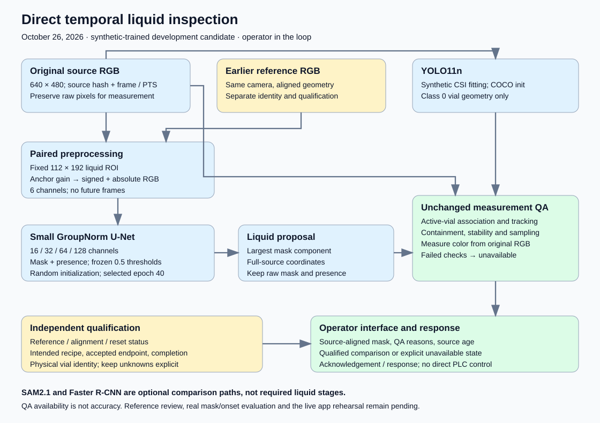
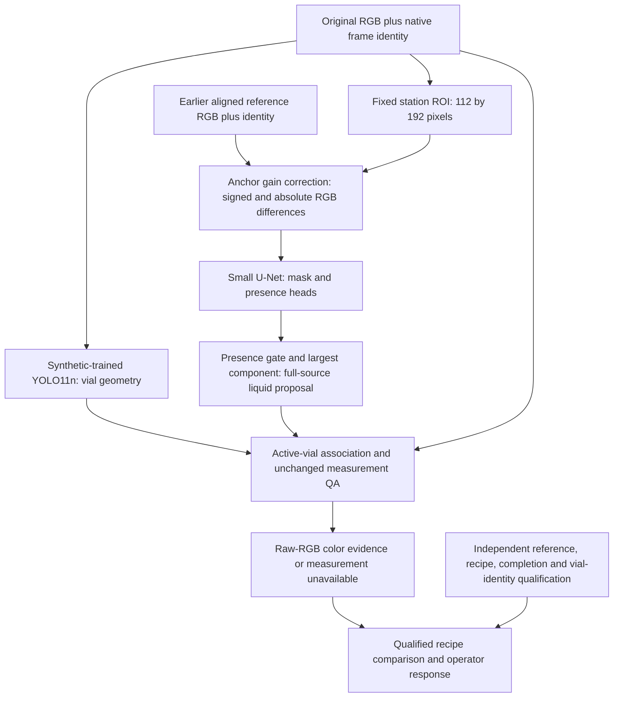

# Temporal CNN handoff — October 26, 2026

This is the current liquid-model handoff for **Srijan's inference integration**
and **Josiah/Hayden's operator app**. Austin explicitly authorized publishing
this scoped model/document handoff to `main`. Unrelated research and application
development stay on `austin-work`; this does not merge that branch wholesale.

The selected liquid branch is a **direct paired temporal U-Net**, without a
required Faster R-CNN or SAM stage. SAM2.1 remains an optional comparator.





The earlier reference is a separate input, not video memory learned by the
network. YOLO supplies vial geometry; it does not move the fixed liquid ROI.
Retain original RGB for measurement. A mask is a proposal, a passed QA check is
sample availability, and neither alone is an approved recipe/product decision.

## Download the exact assets

[Temporal CNN v1 release](https://github.com/ALL-Applied-AI-Network/msoe-ai-club-rockwell-automation-nvidia-hackath-austin-koske-s-team-8e90f213c6/releases/tag/temporal-cnn-v1.0.0)

- `temporal-cnn-assets-v1.zip`: liquid and vial checkpoints, provenance, frozen
  model helper, runnable model-only example, two source-exact Run4 PNGs, frozen
  machine masks/presence, the single-panel MP4 and contact sheet.
- `temporal-cnn-training-v1.zip`: the exact 192 paired synthetic renders/masks,
  scene-family specifications and verified training manifest. These are the
  liquid model's 144 training / 48 development images, not a new training run.
- `CSI-Tuesday-Visit-Guide.pdf` and `guide-v3.zip`: existing visit guide and field
  sheets. Booking, assigned workstation and approved video arrangement remain
  unconfirmed; the guide is not a runtime installer.
- `Temporal-CNN-Architecture.pdf`: single-page current diagram for sharing;
  editable SVG and a PNG are also in this repository directory.
- `SHA256SUMS.txt`: hashes of downloadable assets. Both ZIPs contain their own
  file manifests. Preserve source data and use fresh inference output paths.

The liquid model is randomly initialized and selected at epoch40 using synthetic
development criteria. The vial checkpoint uses generic COCO initialization and
synthetic CSI-domain fitting. It has two classes: `0=vial`, `1=colored_liquid`.
**Use only class0 from that checkpoint in this architecture**; the U-Net supplies
liquid masks/presence. Do not substitute its older liquid detector branch.

| Asset | SHA256 |
| --- | --- |
| Liquid checkpoint | `6714fe32191d8eba230aa87246f38a25c2906c619d60d7ba30c9e60205352eef` |
| Vial checkpoint | `0bfac07a256eaf190416b632ad1f094a6b534309df1bb11a8c175e9d811b56bc` |
| Frozen U-Net helper | `a1bd2e6c2dc80d35743049ace3e37f30fe4c0c8f1cd9aa8614867c90081fd31c` |

## Run the model-only example

Extract the assets ZIP, then run from that extracted directory with an existing
Python environment containing PyTorch, NumPy, Pillow and OpenCV. The tested
versions are in [temporal-pool.in](../../setup/requirements/temporal-pool.in).
Choose the PyTorch wheel for the actual CPU/GPU host; the GB10 and Windows CUDA
wheels differ. No SAM, Transformers, API key, database or browser is needed.

```bash
python temporal_pool.py --checkpoint models/liquid-best.pt --current examples/run4-fill1-f000339.png --reference examples/run4-fill1-f000264.png --out output-positive --device cpu
python temporal_pool.py --checkpoint models/liquid-best.pt --current examples/run4-fill1-f000264.png --reference examples/run4-fill1-f000264.png --out output-self-reference --device cpu
```

The repository equivalent is `python setup/vision/temporal_pool.py` with paths
to those extracted assets. `TemporalPool(checkpoint, device).predict(current,
reference)` is the reusable load-once API. On the approved GB10 use
`--device cuda:0`; local verification uses CPU with CUDA disabled.

Verify all asset hashes and replay both frozen examples on CPU from the repository:

```bash
python setup/vision/verify_temporal_handoff.py --assets PATH/temporal-cnn-assets-v1 --out PATH/fresh-verification
```

Each command refuses an existing output directory and writes `raw_mask.png`,
`component_mask.png`, `proposal_mask.png` and `observation.json`. A rejected
proposal gets an explicit zero proposal mask. Source file/RGB hashes and both
reference and model identities accompany the result. The included expected
outputs are frozen GB10 predictions, not human ground truth. Their CPU replay
checks implementation consistency, not real accuracy. Self-reference output
does not certify that the reference shows an empty vial.

This small runner deliberately executes only the liquid network. It **does not
run YOLO, measurement QA, recipe qualification, a video worker or the dashboard**.
Those remain the integration steps below. Existing research evaluators and
benchmarks are included for inspection; their CLIs require the original frozen
experiment bundles/config/source clocks, not just the two-image example.

## Integrate the model output

1. Preserve original640×480 RGB, decoded frame index, source-video hash,
   native PTS/time base and decoded RGB hash. Do not silently mirror/resize.
2. Maintain the earlier reference independently. Carry its exact identity,
   alignment and human qualification; invalidate/reset on context changes.
   The supplied examples' reference is explicitly **unreviewed**.
3. Load YOLO and U-Net once. Give YOLO PIL/RGB or a correctly converted BGR NumPy
   input. Keep RGB for the liquid model and color measurement. Filter vial class0.
4. Map masks to full-source coordinates. The fixed ROI is
   `[256,240,368,432]`; the gain anchor is `[32,160,80,208]`. Mask/presence
   thresholds remain0.5. Keep raw mask and accepted proposal separately.
5. Feed same-frame vial geometry and the accepted liquid proposal into the
   existing [geometry](../../replay/geometry.py) and
   [measurement](../../replay/measurement.py) QA. These sources are unchanged;
   a model score or SAM score cannot replace their checks.
6. Display source-aligned proposal masks, source age, QA reasons and reference
   status. Compare with the intended recipe only when reference, completion
   and physical-vial identity are independently qualified. Failed/missing
   evidence stays unavailable. Record operator acknowledgement/response.

Srijan's [October26 pipeline review](../integration/SRIJAN-PIPELINE-REVIEW-20261026.md)
contains specific fixes for the original YOLO/R-CNN/SAM wrapper. Reuse its model
loading and orchestration while swapping the liquid branch and adding the QA
observation interface. Do not force U-Net through SAM to satisfy the old API.

## Evidence and limits

The latest matched GB10 trial measures **16.37ms median /24.86ms p95 CV** and
**105/264 QA-eligible samples**. It includes vial inference, liquid processing and
QA; it excludes decoding, transport and display. The264 frames come from six
correlated, repeatedly inspected Run4 clips. QA availability is not mask/onset
accuracy, product accuracy or a camera-to-display latency claim.

No reviewed real mask/onset accuracy or physical deployment is established.
This checkpoint depends on its camera geometry/reference; arbitrary cross-dataset
transfer is unproved. New CSI fitting and checkpoint/threshold selection use
synthetic data. Real images/reviews are evaluation-only. Run5 stays outside
fitting, selection, tuning and sampling decisions.

- [Current architecture and model evidence](../../setup/vision/CURRENT-ARCHITECTURE.md).
- [Exact temporal contract](../../setup/vision/TEMPORAL-POOL-CANDIDATE.md).
- [Synthetic training/stress results](../../setup/vision/SYNTHETIC-ITERATIONS.md).
- [SAM comparison](../../setup/vision/SAM-TEMPORAL-COMPARISON.md) and
  [DINOv3 comparison](../../setup/vision/DINOV3-DIRECT-MASK.md).
- [Tuesday test guide](../integration/CSI-VISIT-20261027.md).
- [Independent human review](../../annotation_review/VISIBLE-POOL-REVIEW.md).

Other referenced operator-app/onboarding implementations and historical
experiments remain on `austin-work` unless explicitly included in this handoff.
This publication changes no deployed app defaults or measurement QA thresholds.
